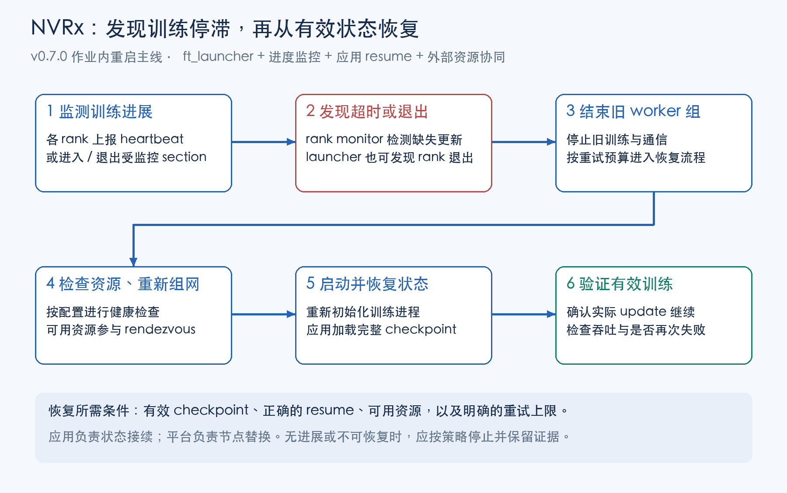

# NVIDIA Resiliency Extension：训练故障检测与恢复

## 1. 功能与优点

NVIDIA Resiliency Extension，简称 **NVRx**，是面向 PyTorch 分布式训练的韧性工具集。核心价值是：**发现训练停滞，在当前作业内组织重启并恢复状态，同时提供 checkpoint 加速、慢 rank 检测与故障归因能力。**

| 能力 | 主要用途 | 价值 |
| --- | --- | --- |
| **作业内重启** | rank 失败或超时后，重启受管理的训练 worker 组 | 尽量减少人工重新提交作业及恢复等待 |
| **FT Sections / Heartbeat** | 按阶段超时或更新间隔发现停滞 | 可以发现“进程还在、训练不动” |
| **异步 checkpoint** | 安全暂存状态后，将序列化和写入放到后台 | 减少保存对训练主路径的阻塞 |
| **Straggler Detection** | 比较代码区间与 CUDA kernel 性能 | 找出持续变慢的 rank，支持周期性生成报告 |
| **Failure Attribution** | 结合日志和历史分析失败、给出重试建议 | 辅助判断继续恢复还是停止无效重试 |
| **Shared Utilities** | 统一日志格式，提供节点内及相关日志聚合工具 | 便于跨 rank、跨运行尝试关联证据 |

**恢复主线：进度监测 → 超时或进程失败 → 结束旧 worker 组 → 重新组网 → 应用加载有效 checkpoint → 验证有效更新继续。**



本文以 **v0.7.0** 为基线，未进行集群实测。该版本推荐通过 `ft_launcher` 使用作业内重启，进程内重启已弃用。NVRx 不会自动修复代码或硬件，恢复仍依赖正确的 resume、可用资源和明确的重试策略。[官方定位与版本说明](https://github.com/NVIDIA/nvidia-resiliency-ext/releases/tag/v0.7.0)

阅读入口：[快速接入](#2-quick-start改哪里如何启动) · [作业内恢复](#3-容错机制作业内重启与-sections) · [异步保存](#4-异步-checkpoint) · [慢-rank-检测](#5-慢-rank-检测straggler-detection) · [失败归因](#6-失败归因分析) · [共享工具](#7-shared-utilities共享日志工具)。

## 2. Quick Start：改哪里、如何启动

先接入 **FT 监测 + 可靠 resume**，确认可以恢复后，再按需加入异步保存、慢 rank 检测和归因；它们不是必须一起启用的开关。

### 2.1 训练代码：增加监测，保留原有训练流程

下面是**结构伪代码**，用 Sections 展示主要改动；初始化、保存与恢复辅助函数由应用实现，不是 NVRx API。先以一个 batch 对应一次 optimizer update 为例。

```python
from nvidia_resiliency_ext.fault_tolerance import RankMonitorClient

initialize_distributed_from_env()  # 沿用原有 GPU 绑定与分布式初始化。

# 新增：每个 rank 都建立到本地 monitor 的连接。
ft_client = RankMonitorClient()
ft_client.init_workload_monitoring()

ft_client.start_section("init")
model, optimizer, data_iterator, start_step = build_and_resume()
# build_and_resume 必须在每次启动时恢复最新完整 checkpoint 和数据进度。
ft_client.end_section("init")

for step in range(start_step, total_steps):
    # 新增：分别约束取数与训练阶段的最长允许时间。
    ft_client.start_section("data_get")
    batch = next(data_iterator)
    ft_client.end_section("data_get")

    ft_client.start_section("step")
    train_one_step(model, optimizer, batch)
    ft_client.end_section("step")

    if should_save(step):
        ft_client.start_section("checkpoint")
        save_checkpoint_at_update_boundary(step + 1)
        ft_client.end_section("checkpoint")

# 正常结束；异常应保留 traceback 并向外传播，不能吞掉后假装训练成功。
ft_client.shutdown_workload_monitoring()
cleanup_distributed()
```

监测初始化前的通信初始化仍需由相关通信超时及平台生命周期约束。保存函数需要覆盖模型、optimizer 和必要的 scheduler、GradScaler、随机状态及数据进度；不能只恢复权重。详见附录。

若使用梯度累计，取数区间应覆盖每个 micro-batch；训练更新计数和保存边界应以实际成功 update 为准。不要把所有 micro-batch 都误计为 optimizer step。

### 2.2 配置文件：为阶段设置超时

以下可保存为 `故障容错配置.yaml`。**单位为秒，数值仅用于解释字段，必须根据正常耗时分布调整**，尤其要覆盖首次编译、预热、评估和恢复。

```yaml
fault_tolerance:
  # 本例只使用 Sections，关闭心跳超时，避免两套阈值相互提前触发。
  initial_rank_heartbeat_timeout: null
  rank_heartbeat_timeout: null
  rank_section_timeouts:
    init: 1800
    data_get: 120
    step: 600
    checkpoint: 1800
  rank_out_of_section_timeout: 600
  log_level: INFO
```

只调用 `start_section()` 不够：v0.7.0 对没有列入 `rank_section_timeouts` 的 section 会跳过对应 IPC 和本地计时。评估等新增阶段应同时加入配置；预热规则也需对照具体版本验证。[Sections 指南](https://nvidia.github.io/nvidia-resiliency-ext/fault_tolerance/integration/sections.html)

### 2.3 启动脚本：从 torchrun 改为 ft_launcher

两台机器、每台 8 张 GPU 的启动结构如下；各节点均执行，保留平台原有的 rendezvous 地址、作业标识和节点身份配置。环境变量由平台提供。

```bash
ft_launcher \
  --nnodes=2 \
  --nproc-per-node=8 \
  --rdzv-id="$JOB_ID" \
  --rdzv-endpoint="$RDZV_ENDPOINT" \
  --max-restarts=3 \
  --ft-cfg-path=故障容错配置.yaml \
  train.py
```

`--max-restarts=3` 是示例预算，不表示所有失败都应该重试三次。v0.7.0 使用 barrier rendezvous，不再使用 legacy 实现；安装后应通过 `ft_launcher --help` 核对实际参数。[FT 使用指南](https://nvidia.github.io/nvidia-resiliency-ext/fault_tolerance/usage_guide.html)

K8s / 应用平台需要允许 launcher 在训练子进程退出后继续组织恢复，并明确谁负责替换坏节点。若平台立刻结束全部容器，作业内恢复会被打断；平台自己的重试也应尊重 NVRx 的停止决定。

## 3. 容错机制：作业内重启与 Sections

### 3.1 什么是作业内重启

**保留当前作业及仍可用的资源，在作业内部重新启动训练进程，再由应用从 checkpoint 接续。**通常不需要用户重新提交整份作业，但训练进程、模型、优化器和通信环境需要重新初始化。

| 方式 | 重启对象 | 在本文中的位置 |
| --- | --- | --- |
| **In-job restart：作业内重启** | launcher 管理的训练 worker 组 | v0.7.0 新接入主线 |
| In-process restart：进程内重启 | 同一进程内重新调用训练函数 | 已弃用，不作为新方案入口 |
| 调度器层重启 | 重新创建、提交或分配作业 | 处理 launcher / 节点等更大范围失效 |

例如，两台 8 卡机器中的一个 rank 卡住，正常恢复路径是处理当前 16-rank worker 组，再重新组网、启动和加载状态。**不是仅拉起一个 rank，让其他 rank 沿用旧 collective。**恢复也不是从失败指令原地继续，可能回放上次完整 checkpoint 之后的工作。

### 3.2 谁负责监测，谁负责重启

```text
每台机器一份 ft_launcher
    ├─ 启动 / 重新启动本机训练 rank
    └─ 为每个 rank 启动独立的 rank monitor

训练 rank ── RankMonitorClient / 本地 IPC ── monitor
各机器 launcher ── rendezvous ── 协调成员与重组
```

rank monitor 相互之间不直接通信。monitor 发现超时后可以终止对应 rank；launcher 发现失败，再按策略处理 worker 组。整机宕机或 launcher 消失时，需要其余协调组件和外部平台参与，不是原 launcher 自行修复机器。[官方架构](https://nvidia.github.io/nvidia-resiliency-ext/fault_tolerance/usage_guide.html#design-overview)

### 3.3 哪些事件会触发故障处理

| 事件 | 如何触发 |
| --- | --- |
| rank 失败退出 | 未捕获异常、进程被终止、CUDA / NCCL 错误导致退出等，由 launcher 发现 |
| 心跳超时 | 首次或后续更新超过有效阈值，由 monitor 发现 |
| Section / 阶段外超时 | 阶段长时间未结束，或未标记区域停留过久 |
| 已启用的运行期健康监测异常 | 按模块策略终止受影响 rank，再进入恢复路径 |

慢 rank 报告分数低、loss 为 NaN、GPU 利用率低，不自动等于触发 FT 重启；需要相应应用策略。健康检查也分运行期监测和重组前资源选择，不应混为“检查失败就立刻重启”。

### 3.4 Sections 主要服务于 timeout

**FT Sections 回答“这段代码是否超过允许时间还没结束”。**独立 monitor 可以在训练线程卡住时继续判断，适合区分取数、训练、保存等阶段的停滞。

| 对比 | FT Sections | Straggler Detection 区间 |
| --- | --- | --- |
| 判断目标 | 是否超时 | 是否比其他 rank 或历史慢 |
| 典型对象 | 仍未结束的阶段 | 已采集到的完整耗时样本 |
| 处理位置 | 独立 monitor | 训练侧 Detector 与报告流程 |
| CUDA kernel 计时 | 不自动提供 | 可通过 CUPTI 采集 |

Heartbeat 则是在主流程合适位置调用 `send_heartbeat()`。后台线程无条件报活会掩盖主训练线程卡住；CPU 发起了 GPU 操作也不等于设备已完成，不宜为了检测机械加入每步同步。[Heartbeat 指南](https://nvidia.github.io/nvidia-resiliency-ext/fault_tolerance/integration/heartbeats.html)

FT Sections 不是通用外部性能指标接口。若要在面板展示当前打开阶段、持续时间和历史事件，需要独立导出链路；`ft_client.state_dict()` 主要保存监控状态，例如计算后的阈值，不是逐次耗时报告。

### 3.5 什么情况下不应继续重启

| 门控 | 作用 |
| --- | --- |
| `--max-restarts` | 限制本轮 launcher 重试预算 |
| 应用控制请求 | 使用 `send_workload_control_request()` 表达停止重试或资源排除等请求 |
| progress tracker | 根据 checkpoint iteration 文件识别跨重启无进展 |
| Attribution STOP | 归因建议停止，且启用了执行停止策略 |

确定性 index / shape / 配置错误、同一坏样本反复失败，应修复或停止，不应无限重启。默认不能认为 launcher 已准确判断所有 bug。

进度跟踪需要有效的 `--ft-checkpoint-iteration-file`，应在 checkpoint 真正完成后更新；它不是实时 step 计数。保存间隔过长、刻意回放等情况需要调整无进展规则。有效 checkpoint 是恢复前提，也不是 launcher 默认替应用完成的完整校验。

NVRx 的“不再重启”退出码默认是 `93`，与重试预算耗尽后的普通失败不同。外层平台应识别停止意图；协调信息读取失败等情况下该信号也可能退化，不能仅凭一个退出码假定全部故障语义。[停止策略](https://nvidia.github.io/nvidia-resiliency-ext/fault_tolerance/usage_guide.html#no-restart-telling-do-not-requeue-apart-from-a-failure)

### 3.6 健康资源从哪里来

NVRx 不直接分配底层调度资源。可以提前提供热备，或由平台替换坏节点。两台 8 卡机器活跃、一台 8 卡机器备用，意味着预留 24 张卡、正常使用 16 张卡。固定规模恢复与缩小 world size 是不同设计，后者还涉及 batch、学习率、采样及分片兼容性。

NIC 运行期监测、重组前健康检查、存储与外部节点服务需按环境启用；有些外部信号不可用时会放行，因此要区分“健康”和“没有取得有效检查结果”。链路 ACTIVE、文件可读，也不能证明吞吐没有异常。[固定版本配置](https://github.com/NVIDIA/nvidia-resiliency-ext/blob/v0.7.0/src/nvidia_resiliency_ext/fault_tolerance/config.py)

## 4. 异步 checkpoint

### 4.1 原理：先保住一致状态，再后台写入

```text
训练：update N → 状态安全暂存 → update N+1 → update N+2 …
后台：                       └─ 序列化 / 写存储 ─→ 完成
恢复点：                                          全局确认与最终提交
```

v0.7.0 的默认异步队列使用持久后台进程。本文使用的简便封装 `TorchAsyncCheckpoint.async_save()` 先在调用侧执行 `preload_tensors()` 暂存状态和 `torch.cuda.synchronize()`，再提交后台写入；通用 `AsyncRequest` 路径还支持通过 `preload_fn` 在后台进程暂存。**训练必须等到快照不再受后续更新影响，才可以安全修改对应状态；异步主要隐藏后台写入，并非保存全程无同步。**[固定版本封装实现](https://github.com/NVIDIA/nvidia-resiliency-ext/blob/v0.7.0/src/nvidia_resiliency_ext/checkpointing/async_ckpt/torch_ckpt.py)

需要区分三件事：安全暂存完成、后台写入完成、全部必要 rank 及元数据最终确认完成。`state_dict()` 本身不是冻结快照，目录出现或提交请求返回，也不能作为有效恢复点的证明。

### 4.2 如何使用：保存接口外增加提交与完成检查

NVRx 提供 `TorchAsyncCheckpoint` 包装 `torch.save`，更复杂的分布式分片保存可用 `AsyncCallsQueue` / `AsyncRequest` 等接口。**易用性在于可复用已有 state_dict 与保存路径，不需要自行实现后台进程和请求队列；状态完整性与最终提交仍由应用设计。**

下面是每个 rank 保存独立文件的结构示意，**不是完整的分布式 checkpoint 提交协议**：

```python
from nvidia_resiliency_ext.checkpointing.async_ckpt.torch_ckpt import TorchAsyncCheckpoint

async_ckpt = TorchAsyncCheckpoint()

for step in range(start_step, total_steps):
    # 检查已完成请求；这里采用每 rank 独立保存，不做全局完成确认。
    async_ckpt.finalize_async_save(blocking=False, no_dist=True)
    train_one_step()

    if should_save(step):
        # 示例保守地限制为一份在途保存，避免积压；必要时会等待。
        async_ckpt.finalize_async_save(blocking=True, no_dist=True)
        state = collect_training_state()  # 应用实现；含本 rank 数据与随机状态。
        path = make_rank_checkpoint_path(step + 1, rank)
        async_ckpt.async_save(state, path)

async_ckpt.finalize_async_save(blocking=True, no_dist=True)
async_ckpt.close()
```

正式分布式接入需要在全部分片完成后协同最终化，再发布完整性标记和最新 checkpoint iteration。跨 rank 的完成检查必须按约定共同调用；纯 DDP 只写 rank 0 的模型权重，也不能忽略其他 rank 的本地数据与随机状态。异常退出需清理后台任务，不应在已故障的通信组上盲目等待 collective。

接口见 [TorchAsyncCheckpoint](https://nvidia.github.io/nvidia-resiliency-ext/checkpointing/async/api/torch_ckpt.html)、[异步保存指南](https://nvidia.github.io/nvidia-resiliency-ext/checkpointing/async/usage_guide.html)。本例未执行；异步保存仍消耗暂存内存、CPU 和 I/O，应与 DataLoader 资源竞争一起评估。

本地 checkpoint 与异步保存是不同维度。本地保存可结合跨节点副本加速恢复，但不能用故障节点上的唯一文件抵御节点丢失；LocalCheckpointManager 的状态类型、world size 和副本限制见[本地保存指南](https://nvidia.github.io/nvidia-resiliency-ext/checkpointing/local/usage_guide.html)。

## 5. 慢 rank 检测：Straggler Detection

### 5.1 检测什么

**先标记关心的区间，采集墙钟与可选 CUDA kernel 时间，再与其他 rank 或自身历史比较，周期性生成分析报告。**先检测 rank，再关联节点；发现一个慢 rank，不等于整台机器已经被确认有故障。

| 数据 | 采集方式 | 适合回答的问题 |
| --- | --- | --- |
| 区间墙钟时间 | 区间进入与退出时 CPU 计时 | 获取 batch、CPU 处理或整个区间是否持续变慢 |
| CUDA kernel 时间 | `profile_cuda=True`，通过 CUPTI 采集 | 相同 kernel 的 GPU 执行性能是否退化 |
| Relative score | 与本窗口最快参考比较 | 少数 rank 是否落后 |
| Individual score | 与该 rank 历史最佳参考比较 | 相比此前是否发生退化 |

相对分数可能看不出所有 rank 同时变慢；历史分数需要控制 shape、batch 和训练阶段。不同 rank 的工作量必须可比，不能把 rank 0 额外保存、日志等工作判成硬件退化。

### 5.2 使用方法：取数、forward、backward 三个区间

以下是**预热后的单 batch / 单 update 训练结构示意**。`emit_report` 是应用的输出函数，可写结构化日志或交给外部采集；不是 NVRx 内置服务。

```python
import torch.distributed as dist
from nvidia_resiliency_ext.attribution import straggler

Detector = straggler.Detector
Detector.initialize(
    scores_to_compute=["relative_perf_scores", "individual_perf_scores"],
    gather_on_rank0=True,
    profiling_interval=10,  # 示例：每个具名区间每进入 10 次采一次。
)

for update_step in range(start_step, total_steps):
    with Detector.detection_section("data_get", profile_cuda=False):
        batch = next(data_iterator)

    batch = move_batch_to_device(batch)
    optimizer.zero_grad()

    with Detector.detection_section("forward", profile_cuda=True):
        output = model(batch)

    loss = compute_loss(output, batch)
    with Detector.detection_section("backward", profile_cuda=True):
        loss.backward()

    optimizer.step()

    if (update_step + 1) % 100 == 0:
        # 每个 rank 在一致位置调用；不能只让 rank 0 生成报告。
        report = Detector.generate_report()
        if dist.get_rank() == 0 and report is not None:
            emit_report(
                step=update_step + 1,
                section_relative=report.section_relative_perf_scores,
                section_individual=report.section_individual_perf_scores,
                gpu_relative=report.gpu_relative_perf_scores,
                gpu_individual=report.gpu_individual_perf_scores,
                rank_to_node=report.rank_to_node,
                stragglers=report.identify_stragglers(),
            )

Detector.shutdown()
```

这段代码没有替换模型、优化器或训练算法。FT Sections 可以在同一业务边界另行接入，但与 Detector 是两套 API，不能自动互通。梯度累计场景下，三个区间可按 micro-batch 采集，报告按一致的 update 边界调用。报告、评估和保存的耗时还需纳入 FT 超时范围。

### 5.3 CUDA 时间怎样采集，哪里会同步

**在 v0.7.0 Straggler 的稳态采集路径中，区间边界不显式调用设备同步；生成报告时才显式执行一次 `torch.cuda.synchronize()`。不是每个 forward / backward 前后各同步一次。**这不表示训练代码或异步 checkpoint 等其他模块没有自己的同步。

```text
进入区间 → 启用 CUPTI CONCURRENT_KERNEL 采集
执行代码 → 退出区间，关闭采集
CUPTI 缓冲区回调 → 读取每个 kernel 的 start / end 时间戳
周期性生成报告 → GPU 同步 → 刷新记录 → 统计、跨 rank 比较
```

底层 C++ 扩展使用 `(kernel.end - kernel.start) / 1000` 得到微秒耗时，不通过 CUDA Event 前后插桩，也不通过 `event.query()` 轮询每个区间。CUPTI 使用工作线程交付活动缓冲区，读取已交付记录本身不等待单个 kernel 完成。

报告前的 GPU 同步会等待当前设备此前提交的工作。随后 `cuptiActivityFlushAll(0)` 也是阻塞调用，但它自身不隐式同步 GPU；锁、统计、跨 rank 聚合和输出还有其他成本。因此，**“区间边界无显式同步”不能写成“完全不阻塞、零开销”**，也不能保证底层驱动绝无等待。

依据：[Detector 源码](https://github.com/NVIDIA/nvidia-resiliency-ext/blob/v0.7.0/src/nvidia_resiliency_ext/attribution/straggler/straggler.py)、[CUPTI C++ 实现](https://github.com/NVIDIA/nvidia-resiliency-ext/blob/v0.7.0/src/nvidia_resiliency_ext/attribution/straggler/cupti_src/CuptiProfiler.cpp)、[CUPTI Activity API](https://docs.nvidia.com/cupti/api/group__CUPTI__ACTIVITY__API.html)。

### 5.4 GPU 时间的含义：kernel 性能，不是阶段总时长

`profile_cuda=True` 采集被选区间内 kernel 的计时，但当前报告将所采集 kernel 汇总为 rank 级 GPU 性能分数，**不是分别输出每个 step 的 forward 和 backward GPU 总区间时间**。

区间墙钟包含 CPU 发起及可能的等待；kernel 耗时相加也可能重复计算并行重叠，并遗漏 kernel 间空隙和数据拷贝。因此不能将 GPU 分数、kernel 总和、阶段墙钟混作同一指标。若目标是严格的每步 GPU 阶段跨度，需要额外设计多 stream 的 CUDA Event 或时间线关联，不能直接用 NVRx 分数代替。

### 5.5 评分原理与分析报告

区间分数主要使用窗口内样本的中位耗时：

```text
相对分数 = 跨 rank 最小的区间中位耗时 / 当前 rank 的区间中位耗时
历史分数 = 本 rank 历史最小的区间中位耗时 / 当前区间中位耗时
```

例如最快 rank 取数 10 ms、某 rank 取数 80 ms，其相对分数为 0.125。GPU 分数先比较可匹配 kernel 的中位耗时，再按各 kernel 的执行时间加权；命名键包含 kernel 名和 grid / block 配置，不表示张量语义必然完全相同。[评分源码](https://github.com/NVIDIA/nvidia-resiliency-ext/blob/v0.7.0/src/nvidia_resiliency_ext/attribution/straggler/reporting.py)

| 报告内容 | 含义与输出范围 |
| --- | --- |
| section_relative / individual_perf_scores | 区间 → rank → 分数 |
| gpu_relative / individual_perf_scores | rank → GPU 性能分数 |
| rank_to_node | rank 与节点对应关系 |
| local_section_summaries | 本 rank 的区间 min / max / median / avg / std / 样本数等统计 |
| local_kernel_summaries | 本 rank 的 kernel 计时统计 |
| identify_stragglers() | 按相应阈值给出异常 rank / 节点集合 |

**支持自动按固定 step 或时间周期生成分析报告，但需要训练循环调用对应方法。**不是安装后自动出现后台分析服务、网页或 Prometheus 端点。报告对象可被应用序列化输出；其中含集合和统计枚举时需先转成输出格式。

`gather_on_rank0=True` 可将各 rank 分数汇总到 rank 0，但不代表所有 rank 的 `local_*` 详细统计也已集中；需要各 rank 原始细节时应分别输出。报告生成后重置本轮采样记录，历史最佳参考用于后续比较。字段见 [Report API](https://nvidia.github.io/nvidia-resiliency-ext/straggler_det/api/reporting.html)。

### 5.6 采样频率与报告频率分别控制

| 设置 | 含义 |
| --- | --- |
| `profiling_interval=10` | 每个具名区间每进入约 10 次采一次，包含该次墙钟及可选 CUDA 采集 |
| 每 100 update 调用 `generate_report()` | 分析期间积累的抽样数据，而不是只分析第 100 步 |
| `generate_report_if_interval_elapsed()` | 在每步共同调用，由时间间隔跟踪决定是否生成报告 |

若区间每 step 进入一次，10 次采一次、100 step 报告一次，大约有 10 个样本。micro-batch、条件分支和不同调用次数会改变实际样本量；区间进入次数不是固定等于训练 step。

### 5.7 开销、长期运行与验证

**取数仅测墙钟、forward / backward 抽样采集 CUDA、低频生成报告，适合作为长期观测候选。**只有三个区间也不能只按区间数量估计开销，主要还取决于 kernel 数量、频率、CPU 资源及报告同步成本。

官方对 kernel profiling 给出通常预期低于 1% 的描述，不能作为整个接入的稳态开销保证。建议先从每区间 10 次采一次、每几分钟对应的 update 数报告一次试验；异常后再加密采样。这是配置起点，不是默认性能承诺。[使用与开销指南](https://nvidia.github.io/nvidia-resiliency-ext/straggler_det/usage_guide.html)

测量时应比较开关前后的稳态吞吐和 step 长尾，并在外层统计完整 `generate_report()` 耗时。报告内部的 `generate_report_elapsed_time` 不含 Detector 前置 GPU 同步等待，不能单独代表总成本。

抽样与中位数可能遗漏偶发慢 step，建议独立保留每 micro-batch 的 `data_get_time` 或长等待事件。生成报告包含 GPU 同步，跨 rank 比较还需要协同调用；即使只计算历史分数、不汇总到 rank 0，也不能据此认为完全无 GPU 同步。卡死时应依赖 FT monitor 和历史堆栈，而不是等 Detector 报告。

### 5.8 与 NCCL Inspector 的区别与联系

NVRx 比较业务区间和 kernel 性能；NCCL Inspector / Profiler 记录 collective、序号、消息大小、kernel / proxy 等通信事件。**通信耗时最长的 rank，可能是在等真正的慢 rank。**

例如某 rank 取数据慢，其他 rank 先进入 AllReduce 并等待，它们的通信时间可能反而更长。v0.7.0 GPU 评分会过滤名称包含 `ncclDev` 的 kernel，避免直接用这类等待评判本卡计算能力；这是名称过滤，不是所有版本、所有通信 kernel 的完整排除保证。

排查时先看 NVRx 的取数与计算异常，再对齐相同 communicator、通信序号、类型和消息大小，区分晚到与通信内部变慢。跨机器时间比较要处理时钟对齐；CPU API 入队时间不等于 GPU 完成。最后关联堆栈、网卡和系统日志验证，不能将低带宽直接判为网卡故障。[NCCL Inspector](https://github.com/NVIDIA/nccl/blob/master/plugins/profiler/inspector/README.md)、[Profiler 事件语义](https://github.com/NVIDIA/nccl/blob/master/plugins/profiler/README.md)

## 6. 失败归因分析

**归因把每轮失败的日志和可用证据整理成解释与重试建议，不等于自动修复根因。**Restart Agent 是实验性能力，可以使用确定性分析、重试历史和可选模型辅助，不必依赖大模型才能工作。

```text
本轮应用日志与可用证据
→ 提取错误和进度信息
→ 比较历史、应用重试规则
→ 输出结构化结果及 STOP / RESTART 建议
```

支持 CLI 生成结果 JSON / trace、Python 调用，以及 attrsvc 服务查询。CLI 可使用 `--disable-l1` 进行确定性分析。服务和历史状态不是天然持久数据库；服务重启可能丢失进程内记录。[Restart Agent](https://nvidia.github.io/nvidia-resiliency-ext/attribution/features/restart-agent.html)

与 `ft_launcher` 集成时，需要配置归因 endpoint 和每轮应用日志。失败后提交分析，launcher 不等待结果完成就可以恢复；终态分析是默认路径，运行期间渐进式预处理需另外启用。外部服务必须能访问提交的日志路径，而不是只收到训练容器内无法访问的文件名。

默认 `--ft-attribution-stop-action log` 只记录判断；启用 `no-restart` 后 STOP 才影响训练，可能停止已经开始的后续恢复轮次。因此应先用历史和隔离故障测试验证准确性，再决定自动停止范围。[服务流程](https://nvidia.github.io/nvidia-resiliency-ext/attribution/features/progressive-ft-launcher-attribution.html)

Flight Recorder 等 trace 路径属于证据能力，现有硬件指标、历史堆栈不会因启用服务就自动成为分析输入。应明确证据采集、访问和解析方式；聚合日志可能缺失故障附近输出，必须继续保留原始 rank / monitor 日志及必要 core dump。

## 7. Shared Utilities：共享日志工具

### 7.1 它做什么

**Shared Utilities 为多进程训练提供通用日志基础设施；这里的 shared 不是共享模型参数，也不是一套完整日志检索平台。**

| 能力 | 功能 |
| --- | --- |
| NVRx Logger | 在日志中补充时间、节点、workload / infrastructure rank、来源等信息 |
| 环境变量配置 | 控制日志级别、输出方式、本地临时目录、轮转大小和保留数量 |
| 节点内日志聚合 | 多进程先写节点本地临时文件，再由聚合服务形成节点日志 |
| 相关跨节点汇总链路 | FT launcher 可通过 gRPC 集中应用日志，按重启轮次组织 |

只需要带 rank 信息的日志时，可从标准输出模式开始：

```python
from nvidia_resiliency_ext.shared_utils.log_manager import setup_logger

logger = setup_logger()
logger.info("Training started")
```

它不会自动捕获所有应用 logger、所有硬件指标或堆栈。Checkpointing、Straggler Detection 有各自日志 / 报告路径，需要显式汇接。[Shared Utilities](https://nvidia.github.io/nvidia-resiliency-ext/shared_utils/index.html)、[Logger 指南](https://nvidia.github.io/nvidia-resiliency-ext/shared_utils/logger_guide.html)

### 7.2 三种日志路径不要混淆

```text
标准输出：训练 / NVRx 日志 → stdout / stderr → 现有平台采集
节点聚合：各进程临时日志 → 独立本地聚合服务 → 节点日志
跨节点汇总：各节点应用输出 → gRPC 汇总端 → 每轮集中日志
```

节点临时目录使用本地存储，最终节点日志仍可写共享存储。v0.7.0 的 Logger setup 主要设置 handler，节点聚合器有独立启动入口；**仅设置 `NVRX_NODE_LOCAL_TMPDIR` 不应视为聚合服务已部署**。聚合器、目录可见性和生命周期需要另外确认。[固定版本 Logger](https://github.com/NVIDIA/nvidia-resiliency-ext/blob/v0.7.0/src/nvidia_resiliency_ext/shared_utils/log_manager.py)、[聚合器](https://github.com/NVIDIA/nvidia-resiliency-ext/blob/v0.7.0/src/nvidia_resiliency_ext/shared_utils/log_aggregator.py)

跨节点 FT 日志推荐 gRPC 单写入端，避免多个节点并发追加同一共享文件；可通过 `--ft-nvrx-logfile` 与 `--ft-per-cycle-applog-prefix` 等配置接入。聚合是尽力而为，不是严格全局因果排序或日志零丢失保证。[FT 日志汇总](https://nvidia.github.io/nvidia-resiliency-ext/fault_tolerance/usage_guide.html#per-cycle-logging-and-grpc-log-aggregation)

### 7.3 已有日志平台时如何选择

如果平台已经支持多节点、多 rank 检索和按重启分组，可继续使用原平台，按需补齐 job、运行尝试、节点和 rank 关联，以及 NVRx monitor 日志、Straggler 报告、归因结果。不需要为了使用 FT 或 Detector 就替换日志平台。

只有高频并发写入成为瓶颈，或归因服务需要稳定的每轮集中日志时，再评估节点聚合或 gRPC 汇总。K8s 中还需安排日志目录挂载、采集权限、聚合进程退出和跨 Pod 重启保留；文档里的日志环境变量示例不是完整训练调度方案。

## 附录：兼容性与验证

### 环境与版本

调研日期为 **2026-10-16**，以 **v0.7.0** 为固定基线；在线文档是滚动内容，个别说明与代码可能不同。本文未安装或运行 NVRx 集群实验，所有代码片段均为接入结构说明，不承诺实际开销、恢复时间或成功率。

v0.7.0 README 的平台范围包含 Linux / Ubuntu、x86_64 与 arm64，PyTorch ≥2.8.0、CUDA / Toolkit ≥12.8；包元数据下限不等于完整发布验证矩阵。发布 wheel / CI 针对 Python 3.12、3.14，元数据允许更宽的范围。manylinux_2_39 wheel 不能直接用于标准 Ubuntu 22.04 的旧 glibc，必要时按固定 tag 构建。

```bash
# 只表示固定版本；需先确认 Python、glibc、CUDA 和 PyTorch 兼容性。
python -m pip install 'nvidia-resiliency-ext==0.7.0'
```

Straggler 示例采用 `attribution.straggler` 路径，不依赖已移除 wheel 的旧 PTL callback。其他后端、GPU 健康检查和旧进程内重启的 NCCL 特定限制应分别核对，不能将某模块约束套用到整个工具集。[README](https://raw.githubusercontent.com/NVIDIA/nvidia-resiliency-ext/v0.7.0/README.md)、[元数据](https://raw.githubusercontent.com/NVIDIA/nvidia-resiliency-ext/v0.7.0/pyproject.toml)、[发布说明](https://github.com/NVIDIA/nvidia-resiliency-ext/releases/tag/v0.7.0)

### 状态完整性与最小验证

恢复至少核对模型、optimizer、scheduler、GradScaler、成功 update、各 rank 随机状态及数据游标；累计窗口内保存还需处理未提交梯度与对应数据。跨节点本地副本需匹配故障域，并验证状态类型、容量及 world size 条件。

| 隔离测试 | 验证点 |
| --- | --- |
| rank 退出 / 停止更新 | 旧 worker 组清理、检测延迟、按预算恢复 |
| 长初始化 / 保存 / 评估 | 正常长阶段不被误杀，阶段外也无检测盲区 |
| 同一坏样本反复失败 | 无进展与停止策略有效，外层平台不无限重建 |
| 保存尚未完成即故障 | 只加载完整恢复点，保留旧 checkpoint |
| checkpoint 节点不可用 | 跨故障域副本或持久状态真实可用 |
| 备用节点替换 | 规模、rank、拓扑与本地数据状态正确 |
| 开启 Straggler | 吞吐、step 长尾、报告总耗时可接受，异常结果可解释 |
| 恢复后实际训练 | 有效 update 与数据进度推进，loss、学习率和吞吐符合预期 |

结果验收看“有效训练重新推进”，不只看新进程启动。保留检测、停止、重组、加载、回放和首个有效 update 的分段耗时；根因诊断仍需结合日志、堆栈和硬件证据。

关联阅读：[通信等待型 GPU Hang](../训练报错排查/训练卡住排查：通信等待型GPU_Hang.md) · [训练慢排查](../训练慢与变慢排查/训练慢与变慢排查SOP.md) · [DDP 状态与更新边界](../../训练系统与效率/DDP分布式训练/DDP分布式训练：从启动到参数更新.md)。
