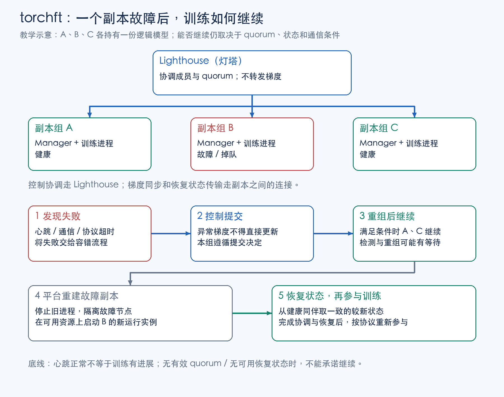
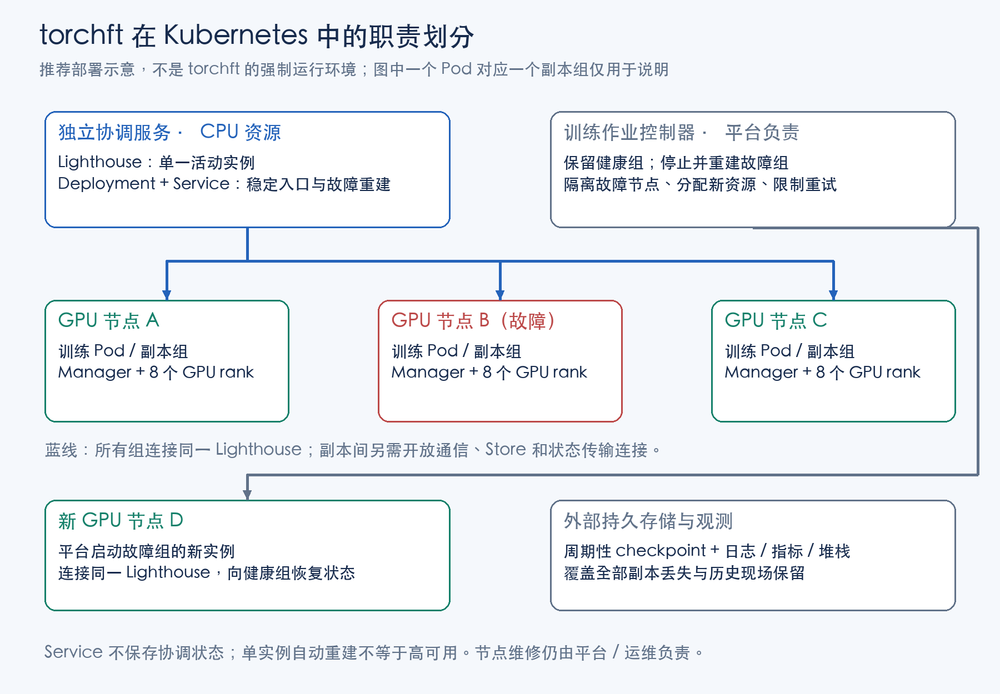

# torchft：稳定性监测、容错与重启

**torchft 的核心价值：某个训练副本失效后，拒绝异常计算的提交，重新组织可用副本；满足协议条件时让健康副本继续训练，再帮助重建的副本恢复状态并重新加入。**

先记住三个分工：**Lighthouse（灯塔）协调成员，Manager 管理训练提交与恢复，平台负责拉起失效进程和更换故障资源。**

| 功能 | 带来的收益 | 使用前提 |
| --- | --- | --- |
| 健康副本继续训练 | 部分副本故障时，减少全部训练进程一起重启的影响 | 仍有满足协议条件的副本与可恢复通信路径 |
| step 提交控制 | 通信失败时，避免把无效梯度直接用于参数更新 | 模型、通信和优化器均接入 torchft，不绕过提交检查 |
| 同伴状态恢复 | 新副本从健康同伴追赶，减少从旧 checkpoint 重放 | 保留可用供体，恢复完整一致状态 |
| 成员与错误观测 | 关联心跳、quorum、提交和恢复过程 | 接入现有日志、指标与进度告警 |

**它不是只修改启动命令的自动重启工具，也不是完整的训练性能监控系统。**接入需要同时处理训练代码、状态语义和平台生命周期。

阅读路径：先看第 1 节的核心概念和第 2 节的 Quick Start；容错细节见第 3—4 节，监测见第 5 节，K8s 接入见第 6 节，与 NVRx 的选择见第 7 节。超时、兼容性与验证清单放在附录按需查看。

本文以同步 DDP / HSDP 路线为主，示例基于固定源码提交，版本和验证边界见附录 B。[官方仓库](https://github.com/meta-pytorch/torchft)。

## 1. 先理解副本组、灯塔和提交

| 概念 | 可以怎样理解 | 需要区分 |
| --- | --- | --- |
| 副本组（replica group） | 共同持有一份逻辑模型的一组训练进程，是讨论副本失效与恢复的单位 | 可以是一个完整模型 rank，也可以是多个分片 rank；不固定等于一台机器或一个 Pod |
| Lighthouse（灯塔） | 接收成员信息，协调本轮参与集合的独立服务 | 不转发梯度，不维修或分配 GPU 节点；不强制部署在 K8s |
| Manager | 训练进程使用的协调接口，连接 quorum、通信重配置、提交和状态恢复 | 每个 rank 使用接口，组内 rank 0 建立服务端；不是每个 rank 一个 Lighthouse |
| quorum | 协议协商出的本轮参与集合及协调结果 | 不是简单的存活名单，也不等于固定机器数过半 |
| 通信组（ProcessGroup） | 真正执行 collective 的进程集合 | 与副本组不同；组内分片通信和跨副本通信需区分 |
| 提交（commit） | 决定本组本轮计算能否用于参数更新的关口 | 不等于 optimizer 已完成，更不等于 checkpoint 已落盘 |

**例子：A、B、C 三个副本组中，B 故障。**A、C 经检测、协调和必要的通信重配置，在条件满足时继续；平台在原节点或新节点启动 B 的新实例，新实例从健康同伴恢复一致状态，再按协议重新参与。检测和重配置期间仍可能等待。



### 1.1 副本组如何对应 GPU

普通 DDP 中，每张卡通常保留完整模型，各 rank 是数据并行副本。torchft 可以用单个训练进程组成一个 **replica group（副本组）**；HSDP 中，一个副本组则可能包含多个 FSDP / TP rank，共同持有一份逻辑模型。

因此，副本组不天然等于一张卡、一台机器或整个作业。先确定故障域和模型分片范围，才能讨论丢失一个 rank 后还有什么状态可恢复。

```text
纯 DDP 示例：每个单卡训练进程可作为一个副本组
  副本组 A：完整模型       副本组 B：完整模型       副本组 C：完整模型

HSDP 示例：三台机器各 8 卡，每台内部组成一个模型分片组
  副本组 A：A0 … A7       副本组 B：B0 … B7       副本组 C：C0 … C7
     组内完成一份模型          组内完成一份模型          组内完成一份模型

  跨副本的数据并行通信：对应的分片位置之间进行，例如 A0 / B0 / C0。
```

这里的 HSDP 布局只是教学例子，不是自动按机器划组。某个组内分片 rank 丢失，可能使该副本组整体不能继续；其他组是否能训练，取决于可用副本、quorum 与通信条件。torchft 不会把任意丢失的 TP / FSDP 分片自动当作可以忽略的独立 DDP 副本。

设计定位见 [官方 README](https://github.com/meta-pytorch/torchft/blob/612a7b0ac49684ab71b61b6af6bc2905a7321f52/README.md)。

### 1.2 组件分工

Lighthouse 负责控制协调；梯度同步与恢复状态传输由副本之间完成。下面按组件明确职责边界。

| 组件 | 核心职责 | 不是它的职责 |
| --- | --- | --- |
| Lighthouse | 根据存活与参与信息形成 quorum，协调副本成员 | 不执行梯度 AllReduce，不扫描所有硬件故障 |
| Manager | 参与本组训练流程、处理成员变化、重配置和恢复 | 不自动重新申请或维修节点 |
| 容错 ProcessGroup | 记录通信错误，支持重配置等恢复路径 | 不能保证任意 CUDA 故障都能在原进程恢复 |
| DDP 包装 | 将梯度同步接入 Manager | 不能与原生 DDP 无条件混用全部高级配置 |
| OptimizerWrapper | 在更新前检查是否可以提交 | 不是忽略错误后照常执行 optimizer.step |
| CheckpointTransport | 从健康同伴传输可恢复状态 | 不等于持久存储中的灾备 checkpoint |

每个训练 rank 在本地使用 Manager 接口；组内 rank 0 创建服务端并向 Lighthouse 协调，其余 rank 通过组内协调参与。不要照搬 NVRx 的“一 rank 一独立监控进程”架构。

参考：[Manager](https://meta-pytorch.org/torchft/manager.html)、[ProcessGroup](https://meta-pytorch.org/torchft/process_group.html)、[Checkpointing](https://meta-pytorch.org/torchft/checkpointing.html)。

## 2. Quick Start：改哪里，如何启动

先用**三个单卡副本组、同一台机器上的三张 GPU**验证 DDP 最小路径；每组只有一个 rank，独立启动一个 torchrun。这是接入教学布局，不是生产集群的推荐故障隔离方式。每台 8 卡的 HSDP 布局需另外定义组内分片通信，不能将下面命令的 `nproc_per_node` 改为 8 就视为完成接入。

### 2.1 Python 侧的四处关键改动

| 改动 | 作用 |
| --- | --- |
| 创建 Manager 与可重配置 ProcessGroup | 接入成员协商、通信错误处理与恢复 |
| 使用 torchft 的 DDP 和 Optimizer 包装 | 梯度同步走 Manager；在参数更新前执行提交检查 |
| 注册状态导出 / 加载回调 | 让落后副本能够恢复模型和 optimizer 等一致状态 |
| 按副本组分配数据 | 避免所有副本重复读取相同数据，单独处理本地加载进度 |

下面是**改造骨架**：`build_dataset`、`build_model`、`compute_loss` 代表项目已有实现，需自行补齐；未包含持久 checkpoint、复杂训练封装和完整退出逻辑，不能当作生产脚本直接运行。接口对照文末固定提交的官方 DDP 示例。

```python
import logging
import os
from datetime import timedelta

import torch
from torchdata.stateful_dataloader import StatefulDataLoader
from torchft import (
    DistributedDataParallel, DistributedSampler, Manager,
    Optimizer, ProcessGroupNCCL,
)
from torchft.checkpointing.pg_transport import PGTransport

logging.basicConfig(level=logging.INFO)

# 示例每组单进程；每个 torchrun 的 LOCAL_RANK 都是 0。
# CUDA_VISIBLE_DEVICES 由各启动命令设置，进程内使用可见设备 0。
torch.cuda.set_device(0)
group_id = int(os.environ["REPLICA_GROUP_ID"])
dataset = build_dataset()
sampler = DistributedSampler(
    dataset,
    replica_rank=group_id,       # 本组在数据分片布局中的位置，示例为 0/1/2。
    num_replica_groups=3,         # 数据分片布局，不是动态存活副本数。
    group_rank=0, num_replicas=1, # 本示例组内只有一个 rank。
    shuffle=True,
)
trainloader = StatefulDataLoader(
    dataset, batch_size=64, sampler=sampler, num_workers=2,
)

# 新增：供恢复者读取、加载的一致状态；在模型和优化器建好后使用。
def state_dict():
    return {"model": model.state_dict(), "optim": optimizer.state_dict()}


def load_state_dict(state):
    model.load_state_dict(state["model"])
    optimizer.load_state_dict(state["optim"])


pg = ProcessGroupNCCL(timeout=timedelta(seconds=60))
transport = PGTransport(pg, timeout=timedelta(seconds=60), device="cuda")
manager = Manager(
    pg=pg,                       # 跨副本容错通信路径。
    min_replica_size=2,           # 本示例至少需要两个参与副本。
    replica_id=f"train_{group_id}",
    state_dict=state_dict,
    load_state_dict=load_state_dict,
    checkpoint_transport=transport,
    init_sync=True,               # 由 Manager 安排初始状态同步。
    max_retries=3,                # 连续提交失败的有限预算，不是进程重启次数。
    quorum_retries=2,             # quorum 失败重试预算，与上一项不同。
)

# 替换原生 DDP：通过通信 hook 将梯度同步接入 Manager。
model = DistributedDataParallel(manager, build_model().cuda())
# 包装底层优化器：zero_grad 发起 quorum，step 检查是否允许提交。
optimizer = Optimizer(manager, torch.optim.AdamW(model.parameters()))

for inputs, targets in trainloader:
    inputs, targets = inputs.cuda(), targets.cuda()
    optimizer.zero_grad()         # 必须在本轮 forward 前调用。
    loss = compute_loss(model(inputs), targets)
    loss.backward()               # 通信失败会进入 Manager 的处理路径。
    optimizer.step()              # 允许提交时才更新；不要绕过包装。
```

`min_replica_size=2` 与后面的 Lighthouse `--min_replicas 2` 是教学配置，不能替代 quorum 的一致性条件。超时和重试预算需按正常 step、重配置和状态传输耗时设置，详见附录 A。

模型与 optimizer 回调只覆盖这个简化示例。真实训练还需处理 scheduler、GradScaler、Manager 元数据、本地 dataloader 进度和应用副作用，见第 4 节。训练结束条件也应基于明确的有效更新 / 数据语义设计，不能假定故障期间每个循环都成功更新。

### 2.2 启动：一个 Lighthouse，三个独立副本组

环境需先按附录 B 选定兼容版本。假设已将上述骨架补齐，保存为 `训练示例.py`，在四个终端分别运行：

```bash
# 终端 1：独立启动协调服务，示例使用默认端口 29510。
torchft_lighthouse --min_replicas 2 --quorum_tick_ms 100 --join_timeout_ms 10000
```

```bash
# 终端 2：副本组 0；本组独立使用 torchrun rendezvous 端口 29600。
CUDA_VISIBLE_DEVICES=0 REPLICA_GROUP_ID=0 TORCHFT_LIGHTHOUSE=http://localhost:29510 \
  torchrun --master_port=29600 --nnodes=1 --nproc_per_node=1 训练示例.py
```

```bash
# 终端 3：副本组 1；与上一组共用 Lighthouse，不共用 rendezvous。
CUDA_VISIBLE_DEVICES=1 REPLICA_GROUP_ID=1 TORCHFT_LIGHTHOUSE=http://localhost:29510 \
  torchrun --master_port=29601 --nnodes=1 --nproc_per_node=1 训练示例.py
```

```bash
# 终端 4：副本组 2。
CUDA_VISIBLE_DEVICES=2 REPLICA_GROUP_ID=2 TORCHFT_LIGHTHOUSE=http://localhost:29510 \
  torchrun --master_port=29602 --nnodes=1 --nproc_per_node=1 训练示例.py
```

**一个 torchrun 管一个副本组，共用一个 Lighthouse 协调跨副本成员。**不要用一个普通全局 torchrun 将三个组绑成“任一进程退出就全部退出”的同一故障处理范围。这些命令展示启动关系，没有配置自动重启；失效组的拉起与重试由 supervisor / 作业控制器负责。

跨机器运行时，`localhost` 换成所有训练进程可达的 Lighthouse 地址，同时确认 Manager、Store、状态传输和 collective 的地址与端口可达。K8s 资源和重建要求见第 6 节。

### 2.3 最先验证什么

先确认三个组正常更新，再在隔离环境让一个组退出，观察其他组的 quorum、commit 和实际训练进展；随后由外部重新启动该组，检查恢复 step、模型及 optimizer 状态。启动成功和进程存活都不能代替这两项验证，完整清单见附录 C。

接口依据：[官方 DDP 示例](https://github.com/meta-pytorch/torchft/blob/612a7b0ac49684ab71b61b6af6bc2905a7321f52/train_ddp.py)、[OptimizerWrapper](https://github.com/meta-pytorch/torchft/blob/612a7b0ac49684ab71b61b6af6bc2905a7321f52/torchft/optim.py)、[启动说明](https://github.com/meta-pytorch/torchft/blob/612a7b0ac49684ab71b61b6af6bc2905a7321f52/README.md#lighthouse)。


## 3. 容错机制：从 quorum 到提交与重建

### 3.1 开始：确定本次参与者

在新一轮开始时，Manager 发起 quorum 协调，必要时重配置通信组，并为掉队成员安排恢复。quorum 是本轮协议决定使用的参与集合，不是“当前机器列表”的另一个名字。

可以异步协调，以争取与本地 forward 重叠，但相关通信和提交使用结果前仍需满足依赖。成员变化不能靠用户简单修改 WORLD_SIZE 环境变量代替。

### 3.2 计算：记录通信失败，避免立即扩散

训练执行本地 forward、backward，并通过容错通信路径同步梯度。部分包装路径会将通信错误记录到 Manager，以默认结果或后续 no-op 让程序到达统一处理位置。

**这种“没有立刻向上抛异常”不代表梯度可用。**如果绕过提交检查，直接使用异常通信产生的梯度更新参数，就破坏了容错语义。

### 3.3 提交：决定能否更新

`should_commit()` 应在 backward 后、优化器更新前执行。同一个副本组内各 rank 需要共同参与并得到一致决定；不同副本组可能得到不同结果。不能把它理解为“所有副本永远同时成功或同时回滚”的全局事务。

Quick Start 中的 `zero_grad()` 和 `step()` 已通过 OptimizerWrapper 连接这些关口；不要在外面重复调用同一轮 `start_quorum()` / `should_commit()`。该包装不支持 closure，不能绕过它直接调用底层优化器。

### 3.4 恢复：从一致的较新状态追赶

新加入或落后的副本可通过 transport 向选定健康同伴取状态，并在协议安排的边界应用。协议要求相同已提交 step 的副本具有一致模型状态，成员切换还需要满足一致性前提。

这类 live recovery 可以减少从较旧持久 checkpoint 回放的需求，但无法替代所有健康副本都丢失时的持久恢复。参见 [协议说明](https://meta-pytorch.org/torchft/protocol.html)。

### 3.5 什么情况会重配置，什么情况需要重启

| 故障 | torchft 可能承担的工作 | 外部仍要做的工作 |
| --- | --- | --- |
| 跨副本通信失败且后端可恢复 | 标记失败、拒绝提交、重新配置通信 | 判断异常持续性与根因 |
| 一个副本进程崩溃 | 在剩余条件满足时排除它，让可用组继续 | supervisor / torchrun 等重新拉起失效进程组 |
| HSDP 组内 rank 丢失 | 在副本组层面处理失效影响 | 重建该组所需分片进程、设备及内部通信 |
| CUDA context 损坏、GPU hang 无法安全退出 | 不能保证原进程继续 | 退出进程、隔离硬件，按实际故障处理 |
| 多数可用副本或全部状态丢失 | 可能无法形成可继续的训练集合 | 停止、修复资源，从持久 checkpoint 恢复 |
| 确定性模型 / 数据错误 | 有限重试与证据关联 | 修代码 / 数据，避免同一故障循环 |

“健康组继续”“通信组重配置”“掉队组恢复”“操作系统进程重新启动”是不同动作。torchft 不会自动获得新机器，也不是任意 CUDA 异常都能在原进程修复。

NCCL 恢复能力依赖具体后端与软件组合；固定版本 ProcessGroupNCCL 的说明也保留了错误处理可能死锁的限制。因此测试必须覆盖 GPU 卡住、异步通信及退出路径，不能只用 Python raise 验证。见 [ProcessGroup 实现](https://github.com/meta-pytorch/torchft/blob/612a7b0ac49684ab71b61b6af6bc2905a7321f52/torchft/process_group.py)。

### 3.6 重试门控：代码 bug 不应无限重启

通信或提交失败可能触发本轮拒绝提交、重新协调；进程崩溃或不可安全恢复的设备故障则需要外部重建。两条路径使用不同预算：Manager 的失败重试控制协议尝试，torchrun / 作业控制器控制进程重新启动。

应用可使用有限的 `max_retries` / `quorum_retries`，平台另设有限重启次数，并保留最早错误和退出原因。相同输入稳定复现的 index 越界、tensor shape 错误等应转向修代码 / 数据；torchft 不会自动证明它是暂态故障，也不提供通用的“代码 bug 自动识别后停止”保证。


## 4. 状态恢复与 checkpoint

### 4.1 同伴恢复和持久 checkpoint 解决不同问题

| 路径 | 数据来自哪里 | 主要解决什么问题 |
| --- | --- | --- |
| 同伴状态恢复 | 协议选定的健康副本，通过 CheckpointTransport 传输 | 新加入或落后的副本追赶当前可用的一致状态 |
| 持久 checkpoint | 共享存储 / 对象存储等外部恢复点 | 全部副本退出、供体消失、作业停止后的恢复 |
| 异步 checkpoint | 由单独选用的保存实现负责 staging 与后台写出 | 降低持久化对训练关键路径的影响 |

**torchft 的同伴恢复不能直接等同于 NVRx 的异步 checkpoint。**`state_dict` / `load_state_dict` 回调定义可传输的恢复状态，`PGTransport` 等负责传输；它们不会自动替应用完成持久化策略、后台写盘和发布完成标记。

最小接入先把一致状态的导出和恢复做对；持久保存可沿用经过验证的 checkpoint 方案。若加入异步保存，还需单独处理快照一致性、GPU 到主机 staging、后台写入完成、失败重试与内存占用，不能把返回一个 `state_dict()` 当作已经获得不可变快照。

实现入口：[Checkpointing](https://meta-pytorch.org/torchft/checkpointing.html)、[官方 DDP 示例的持久保存要求](https://github.com/meta-pytorch/torchft/blob/612a7b0ac49684ab71b61b6af6bc2905a7321f52/train_ddp.py)。

### 4.2 模型状态与数据状态分别处理

恢复回调需要覆盖模型和 optimizer，按应用加入 scheduler、GradScaler 等状态。周期性 checkpoint 还需保存 Manager 的 state_dict，以恢复 step 与 batches_committed 等协议元数据。

数据游标通常属于副本组本地状态，不能将供体的 dataloader 位置机械复制给所有恢复者。torchft 数据文档建议使用 StatefulDataLoader 保存本地加载进度，同时明确当前 sampler 在故障和重新加入时可能丢弃 batch，停机副本的数据也可能缺席。

**故障下继续训练，不代表数据严格读一次，也不保证完整 epoch 覆盖。**小数据集、精确样本覆盖和合规审计场景需要单独设计数据语义。参考 [数据接口与限制](https://meta-pytorch.org/torchft/data.html)。

### 4.3 参与规模变化

DYNAMIC 模式根据可用参与副本归一化梯度；FIXED_WITH_SPARES 用固定活跃贡献规模，额外备用参与者不贡献有效梯度。不要把后者理解为所有备用 GPU 都完全不参与任何操作。

模式不自动解决变长 batch / token 权重、学习率、采样和优化目标问题。应记录有效参与者、样本 / token 数，而不只记录总卡数。缩小训练规模后还在更新，不等于与原始固定规模训练数值等价。

被拒绝提交也不等于自动回滚全部 forward 副作用。可变 buffer、应用计数器和外部写入需要明确是否属于一致性状态，不能只验证模型权重。

### 4.4 不直接移植原生 DDP 的全部训练封装

torchft 的 DDP 包装依赖 Manager 的初始状态同步，对高级 DDP 特性有兼容性边界。梯度累计、no_sync、AMP 溢出跳步、梯度裁剪与 scheduler 更新，需要验证它们是否与 quorum / commit 边界一致。

例如，不能在每个 micro-batch 都按普通习惯调用带有 start_quorum 副作用的 zero_grad；也不能让 GradScaler 只在一个副本跳过协议调用。这里不提供未经验证的“完整 AMP 累计脚本”，优先从固定版本官方最小示例逐步扩展。相关限制见 [DDP API](https://meta-pytorch.org/torchft/ddp.html)。

## 5. 稳定性监测：看存活、进展和恢复结果

### 5.1 心跳不等于训练进度

固定版本 Rust Manager 的后台任务周期性向 Lighthouse 发心跳；Lighthouse 按最后收到的时间判断服务存活。它不读取 GPU 利用率和功率，也不直接证明当前 backward 已完成。

因此需要分层判断：

| 信号 | 能说明什么 | 不能单独说明什么 |
| --- | --- | --- |
| 心跳持续 | Manager 与协调服务仍能通信 | 训练一定在推进 |
| 提交计数前进 | Manager 协议接受了新的更新边界 | optimizer 已完成、数据完全正确、checkpoint 已落盘 |
| optimizer 更新、loss 与吞吐 | 应用实际执行与性能状况 | 故障根因已经解决 |
| 持久 checkpoint 完成标记 | 有一个可确认的恢复点 | 之后所有训练步骤都已持久化 |

源码中，Manager 的 step 计数在提交被允许后更新，OptimizerWrapper 随后才调用底层 optimizer。监控不应把这个计数等同于设备更新完成或持久化完成。后台心跳实现见 [Rust Manager](https://github.com/meta-pytorch/torchft/blob/612a7b0ac49684ab71b61b6af6bc2905a7321f52/src/manager.rs)。

### 5.2 可以使用的监测入口

| 已有入口 | 可获取信息 | 使用注意 |
| --- | --- | --- |
| Lighthouse 状态页面与日志 | 参与者、心跳、quorum、最新 step 等 | 状态页不是完整监控告警系统 |
| torchft_quorums 日志 | 成员重配置及 quorum 信息 | quorum_id 变化也可能由提交失败触发，不能全算作节点丢失 |
| torchft_commits 日志 | step、quorum、commit_result 等 | 按副本组区分，避免重复聚合 |
| torchft_errors 日志 | 错误及上下文 | 与第一处代码 / 系统错误、堆栈关联 |
| Manager API | current_step、num_participants、errored、batches_committed | 部分查询会等待 quorum，不能随意从后台线程并发调用 |
| profiler 标记 / Flight Recorder 相关路径 | quorum、重配置、恢复、提交等耗时证据 | 依赖版本与采集配置，不是默认完整现场快照 |

上述日志入口可在 [固定版本 Manager 源码](https://github.com/meta-pytorch/torchft/blob/612a7b0ac49684ab71b61b6af6bc2905a7321f52/torchft/manager.py)核对。将这些日志接入现有监控系统，需要配置收集与聚合；不能据依赖列表含 OpenTelemetry 就认定已有开箱即用的完整指标面板。

`batches_committed()` 统计跨副本提交的 batch 数，不是样本数或 token 数。失效期间参与规模变化时，它与 step 次数也不再是固定倍数。

### 5.3 建议增加的指标与告警

以下为接入设计，不是 torchft 已内置的指标名称：

- **无进展**：心跳存在，但在合理阶段时限内没有成功更新；同时排除 checkpoint、评估和预热。
- **持续提交失败**：按副本组统计连续失败次数与失败原因，设置有限重试。
- **成员抖动**：quorum 频繁变化、同一资源反复退出和加入。
- **恢复耗时**：拆分检测、进程拉起、quorum、通信重配置、状态传输和恢复后首个有效 update。
- **可用副本接近下限**：余量持续下降，避免只看总 GPU 数量。
- **有效吞吐退化**：训练还在运行，但可用副本减少或重配置过于频繁，实际产出下降。

将日志与 job、replica group、组内 rank、quorum_id 和运行尝试关联；不要只依赖重启后可能变化的进程编号。日志与 trace 原始证据仍需跨故障保留。

### 5.4 训练阶段计时、慢 rank 与失败归因怎么补

torchft 的后台心跳服务于成员存活判断，不能当作 NVRx FT Sections 的代码段超时监控；quorum 和通信超时也不能完整覆盖 Python 数据处理卡住等无进展情况。需要按训练阶段增加应用进度与超时告警。

| 监测目标 | 建议入口 | 结果如何使用 |
| --- | --- | --- |
| 数据获取慢、CPU 等待 | 每 rank 的 `data_get_time`、CPU 墙钟计时、堆栈 | 定位未及时进入计算 / 通信的副本 |
| GPU forward / backward 与通信耗时 | PyTorch Profiler、CUDA Event 或独立的 GPU 采集工具 | 对齐不同 rank 的时间线，区分计算慢与通信等待 |
| 恢复慢 | torchft 日志与 profiler 标记，加平台调度时间 | 拆分检测、拉起、重配置和状态传输瓶颈 |
| 首发故障及硬件问题 | 错误日志、堆栈、NCCL / 系统 / 网卡 / GPU 证据 | 找根因并决定是否隔离资源，避免只看最后一次超时 |

这些是外部观测接入建议，不是 torchft 内置的完整慢 rank 分析或硬件归因系统。CPU 侧调用起止时间只反映提交 GPU 工作的时间，不能直接作为 CUDA 执行耗时。

### 5.5 是否有额外开销，能否低频输出

存在 quorum、提交检查、成员变化时的通信重配置与状态恢复开销；异步 quorum 可以争取和 forward 重叠，但不能消除依赖等待。不要未经测量就给出固定百分比。

基础存活、错误和实际训练进展应持续采集；详细 trace 可按窗口开启。可以由应用每 N 个 step 汇总输出日志，但这只是**降低观测输出频率，不能把协议所需的协调 / 提交检查也改为每 N step 执行**。Manager 查询中可能等待 quorum 的调用，应在合适的训练线程和边界使用。

GPU 计时是否需要同步、何时等待，取决于选用的采集工具。NVRx Straggler Detector 的 CUPTI 与 report 行为不能直接套用到 torchft；额外插入 CUDA 同步可能改变训练性能，需要单独评估。性能验证应对比相同硬件、模型、有效 batch 和采样窗口下的 step time、有效吞吐及恢复耗时。


## 6. Kubernetes 与平台接入

### 6.1 Lighthouse 是否必须部署在 K8s

**不必须。**Lighthouse 是可以独立启动的服务，官方示例通过 `torchft_lighthouse` 启动，再让训练进程通过 `TORCHFT_LIGHTHOUSE` 指向它。裸机、虚拟机或 K8s 都可以承载这一服务；K8s 是部署与资源管理的选择。

例如，假设平台已创建名为 `torchft-lighthouse`、端口为 `29510` 的 Service，同一 namespace 内的训练容器可配置：

```bash
# 示意配置：所有参与同一容错协调域的副本连接同一活动 Lighthouse。
# 它不是训练启动命令，也没有完成 Manager、模型和优化器的接入。
export TORCHFT_LIGHTHOUSE=http://torchft-lighthouse:29510
```

这个地址只解决“到哪里找协调服务”。训练进程之间的 Store、Manager、梯度通信和 checkpoint transport 仍需分别可达。跨 namespace 时应使用对应的 Service DNS 名称。

独立启动及环境变量见[固定版本 README](https://github.com/meta-pytorch/torchft/blob/612a7b0ac49684ab71b61b6af6bc2905a7321f52/README.md#lighthouse)。

### 6.2 K8s 平台必须具备的能力

下表是**在 K8s 上实现预期容错行为的接入要求与设计建议**，不表示 torchft 自带相应控制器，也不表示必须采用某个特定 Operator。



| 能力 | K8s / 平台需要做什么 | 为什么影响容错 |
| --- | --- | --- |
| 独立协调服务 | 建议将 Lighthouse 部署为独立 Pod，以单一活动实例和稳定 Service 提供入口；预留 CPU / 内存，避免与高负载训练争抢资源 | GPU 节点失效时，不应连带丢失唯一协调服务；所有副本必须连接同一实例 |
| 按故障域重建 | 检查所用 Job / PyTorchJob / 自研控制器的失败策略，只重建需要重建的副本组及其依赖进程 | 如果任一 Pod 失败就终止全部健康组，会失去保留健康组继续训练的收益 |
| 明确组与资源映射 | 显式管理副本组、组内 rank、Pod 和节点的关系；组跨 Pod 时联合管理所需分片 | 一个分片进程丢失可能影响整个副本组，不能一律只重启单卡进程 |
| 停止旧实例、隔离坏节点 | 确保旧进程不再参与；记录运行尝试身份，清理旧连接；对异常节点停止调度并安排检测，在健康资源上重建 | 防止新旧实例同时参与；重新调度 Pod 不等于修复硬件或重启物理节点 |
| 控制与数据网络 | 保证 Worker 到 Lighthouse，以及副本间 Manager / Store / 状态传输 / collective 所需连接可达；校验对外通告地址与 NetworkPolicy | 只有 Lighthouse 端口可达仍不足以训练；NCCL / RDMA 能力需按实际后端配置 |
| 持久状态与证据 | 提供外部 checkpoint 存储、跨重启日志、指标和堆栈保存 | 健康同伴恢复不能覆盖全部副本状态丢失；Pod 重建后仍需保留故障证据 |
| 重试与资源预算 | 统一 torchft、torchrun 和作业控制器的重试范围；预留替换资源，设置重试上限 | 避免外层提前杀死健康组，或对同一确定性错误无限拉起 |

**最先检查作业控制器的失败策略。**K8s 能重新创建 Pod，不代表现有训练平台已经支持“一个副本组失败、其他副本组保留”。具体行为取决于当前控制器和配置，需要实际验证。

### 6.3 Lighthouse 的单点与重建边界

可采用 `Deployment` 的 `replicas: 1` 管理单实例，但**不能仅靠这个字段认定始终只有一个活动服务**：默认滚动更新可能产生新旧 Pod 重叠。可考虑 `Recreate` 更新策略来避免常规更新时主动滚动并存；网络分区或强制删除等情况下，仍需确认旧服务真正停止，不能把该策略当成完整的单实例隔离保证。

不要直接将多个独立 Lighthouse 放在同一个 Service 后负载均衡。它们可能形成不同成员视图，破坏协调前提。单实例自动重建提高可用性，但**不等于协调状态复制或无中断高可用**；Service 保持入口稳定，也不会保存 Lighthouse 内存中的状态或原有连接。服务重启后的重连、quorum 和训练状态一致性必须单独验证。

探针也应分层：Lighthouse 进程或服务不可用可以触发服务重建；暂时没有 quorum、训练 step 暂停应结合阶段与超时诊断，不能直接视为所有 Pod 都应该被杀。PDB 可减少部分自愿驱逐，不能防止节点故障，也不能替代状态恢复。

依据：[torchft 协议假设](https://meta-pytorch.org/torchft/assumptions_and_recommendations.html)、Kubernetes [Deployment 更新策略](https://kubernetes.io/docs/concepts/workloads/controllers/deployment/#strategy)、[Service](https://kubernetes.io/docs/concepts/services-networking/service/)、[Disruptions / PDB](https://kubernetes.io/docs/concepts/workloads/pods/disruptions/)。上述 K8s 组合需在具体作业控制器和网络配置下验证。

### 6.4 与现有日志和重启管理衔接

已有多节点、多 rank 日志检索及按重启分组能力时，直接增加 torchft 的副本组、quorum 与提交字段。统一关联 job、replica group、组内 rank、运行尝试和故障节点，保留第一次错误、恢复耗时与最终结果。

由平台明确“只重建哪个组”“谁有权重试”“何时隔离节点”。应用负责提交与状态一致性，平台负责进程和资源生命周期；两者通过日志与恢复结果联动，避免建立相互冲突的重启循环。


## 7. 与 NVRx 的取舍与接入成本

此表比较 torchft 的同步 DDP / HSDP 路线与 NVRx v0.7.0 的主要作业内恢复路线，不表示两者全部组件一一对应。

| 维度 | torchft | NVRx |
| --- | --- | --- |
| 主要恢复思路 | step 级成员协调、提交控制、同伴状态恢复 | 进度检测、worker 组重启、checkpoint 接续 |
| 故障后健康部分 | 条件满足时尽量继续，不要求所有组一起重启 | launcher 重启当前受管理 worker 组 |
| 活性与进度判断 | 后台心跳、quorum、通信与 commit 等 | 训练侧 heartbeat / sections、monitor 超时等 |
| 现场诊断 | 错误日志、通信 / profiler 证据，需接现有工具 | 还提供独立慢 rank、健康检查及实验性归因模块 |
| 接入位置 | 模型 / 优化器 / 通信 / 状态和副本布局 | launcher、进度埋点、checkpoint 与外部资源协同 |
| 最重要的状态约束 | 协议元数据、同一步状态一致、供体恢复 | 完整且可恢复的 checkpoint 与重启边界 |

选型应根据目标故障域、状态恢复能力和平台生命周期决定。想先自动发现卡住并从既有 checkpoint 重启，可以从 NVRx 路线评估；想减少部分副本失效对健康组的影响，需要进一步验证 torchft 的副本组织与 step 提交语义。这是接入建议，不是实测优劣结论。

两者可以探索分层协作，但不能直接叠加默认配置：如果外层 launcher 发现任一进程失败就终止全作业，torchft 保留健康组继续训练的收益会消失。应先定义故障处理范围和唯一的最终重试预算。

关联阅读：[NVIDIA Resiliency Extension 专题](NVIDIA训练韧性扩展：故障检测与恢复.md)。

| 需要评估的成本 | 为什么不能忽略 |
| --- | --- |
| 训练代码改造 | 不只增加心跳，还涉及模型、优化器、通信和恢复回调 |
| 副本与故障域设计 | 分片组失效、节点失效和跨副本失效的处理范围不同 |
| 状态与数据语义 | 动态参与规模、被拒绝的 batch、数据进度和副作用需明确 |
| 协调服务与替换资源 | Lighthouse 可用性、网络可达和重建资源影响恢复效果 |
| 框架兼容与收益验证 | 高级 DDP / AMP / 累计 / 分片组合需测试，收益受模型和故障模式影响 |

如果目标首先是“发现卡住后按 checkpoint 重启”，可先验证较少侵入的恢复链路；如果目标是“部分副本故障时保留健康组继续”，再评估 torchft 的改造成本与实测收益。不能只凭进程能继续运行就认定方案最优。


## 附录 A：超时与 quorum 配置

| 配置 | 控制的等待 | 设计重点 |
| --- | --- | --- |
| Manager heartbeat_interval | 后台心跳发送间隔 | 与 Lighthouse 的失活判断配合 |
| Lighthouse heartbeat_timeout_ms | 多久没心跳视为副本失活 | 与拥塞、服务负载和故障检测目标匹配 |
| Lighthouse join_timeout_ms | 等仍心跳正常的慢成员加入 quorum | 太短可能造成排除 / 重组；太长延后恢复 |
| Manager quorum_timeout | 等待 quorum 的时限 | 覆盖合理 step 波动及恢复路径，防止级联退出 |
| Manager timeout / ProcessGroup timeout | 通信、提交及部分恢复操作 | 区分具体调用和后端，不作为同一个总截止时间 |
| connect_timeout | 建立控制通信连接 | 不等于训练或状态传输全部耗时 |
| max_retries / quorum_retries | 连续提交失败 / quorum 失败重试 | 分清两个预算，不等同于调度器重启次数 |

`min_replicas` 是 Lighthouse 的最小成员配置，`min_replica_size` 是 Manager 的最低训练副本数，需要一致规划。满足一个最小数字不代表可以忽略其他 quorum 条件。

官方假设强调成员切换需要有效交叠，并应避免副本连接不同 Lighthouse 形成分裂视图。不要把 quorum 简化为“原始机器数过半”或“只要剩一台就一定能继续”。具体规则见 [Lighthouse 源码](https://github.com/meta-pytorch/torchft/blob/612a7b0ac49684ab71b61b6af6bc2905a7321f52/src/lighthouse.rs)和 [协议假设](https://meta-pytorch.org/torchft/assumptions_and_recommendations.html)。

Lighthouse 本身是重要单点，应单独部署、监控和设置恢复策略。自动重启它不等于拥有自动复制全部协调状态的高可用集群；服务重启后的重连与一致性需要测试。

## 附录 B：版本、安装与兼容性

调研日期为 **2026-10-16**；机制与源码基线为官方 main 提交 `612a7b0ac49684ab71b61b6af6bc2905a7321f52`。在线 API 文档为滚动 main；PyPI 当日发布版本为 0.2.0，不能据此认定 main 的所有能力都包含在该包中。本文没有集群实测结果。

调研时 PyPI 包为 0.2.0；固定提交的构建元数据要求 Python ≥3.9、torch ≥2.7，并通过 Rust / maturin 构建扩展。依赖下限不是完整兼容性矩阵，实际后端还需匹配 PyTorch、NCCL、CUDA、编译 ABI 和硬件条件。

安装发布包可固定版本，但它不保证等同于本文调研的 main 提交：

```bash
python -m pip install 'torchft==0.2.0'
```

本命令未在此专题中执行。要复现源码基线，应使用固定提交构建，并核对该提交的依赖及安装说明；不把 nightly、发布 wheel 和当前 main 混成同一个版本。

官方 train_ddp.py 是功能演示，含数据下载及为扩大通信窗口而添加的大型中间参数，不是默认轻量生产模板；应先检查显存和数据条件再运行。部署时还需允许 Lighthouse、Manager、Store 和 checkpoint transport 的必要通信，而不只是开放一个 NCCL 端口。

## 附录 C：接入验证清单

1. **定义副本组和故障域**：分清一张卡、一台机器、一个分片组以及整个训练作业。
2. **跑通无故障路径**：确认参数更新、初始同步、quorum 和日志能对应。
3. **接入监测**：关联心跳、commit、参与规模和实际 update，保留历史堆栈。
4. **验证失效后继续**：拒绝异常梯度提交，同时检查健康组状态与数值一致性。
5. **验证重新加入**：外部拉起后，供体选择、状态传输及本地数据进度正确。
6. **测试不可恢复情况**：控制无限重试，验证全局停机后的持久 checkpoint 恢复。
7. **再加入真实训练复杂度**：逐项接入 AMP、累计、分片、动态 shape 和生产数据。

| 隔离测试情景 | 需要观察的证据 | 验收重点 |
| --- | --- | --- |
| 指定副本退出 | 失活时间、quorum 变化、其他组 commit | 没有使用失效通信结果更新 |
| 心跳正常但训练停滞 | 心跳与 update 分离、quorum / 通信等待、堆栈 | 能报警，且不会只按心跳误报健康 |
| 同组一个分片 rank 失败 | 组内提交与成员处理 | 不让半个副本继续错误更新 |
| 重新拉起落后组 | donor、恢复 step、状态传输耗时 | 参数、optimizer 和 Manager 状态匹配 |
| Lighthouse 不可达或重启 | 连接 / quorum 超时、重试及退出 | 没有形成两个相互矛盾的训练视图 |
| 连续提交失败 | 失败计数、错误原因、重试边界 | 能停止无效循环 |
| 副本减少、批次变化 | 有效 batch / token 与参与数 | 梯度归一化、调度计数符合定义 |
| 全部副本退出 | 持久 checkpoint、数据和 Manager 状态 | 能按定义恢复，而非依赖已消失的供体 |

此表是建议实验，不代表已经执行。最终指标应看恢复后的有效训练产出、误判与数据语义，而不只是新进程能启动。

结合 [GPU Hang 堆栈定位](../训练报错排查/训练卡住排查：通信等待型GPU_Hang.md)、[训练慢排查](../训练慢与变慢排查/训练慢与变慢排查SOP.md)和 [DDP 原理](../../训练系统与效率/DDP分布式训练/DDP分布式训练：从启动到参数更新.md)使用。

## 官方资料

- [固定提交 README](https://github.com/meta-pytorch/torchft/blob/612a7b0ac49684ab71b61b6af6bc2905a7321f52/README.md) / [PyPI 0.2.0](https://pypi.org/project/torchft/0.2.0/)：定位与版本入口。
- [Protocol](https://meta-pytorch.org/torchft/protocol.html) / [Assumptions](https://meta-pytorch.org/torchft/assumptions_and_recommendations.html)：一致性前提与限制。
- [Manager](https://meta-pytorch.org/torchft/manager.html) / [Optimizers](https://meta-pytorch.org/torchft/optim.html) / [DDP](https://meta-pytorch.org/torchft/ddp.html)：训练循环接入。
- [Process Groups](https://meta-pytorch.org/torchft/process_group.html) / [Checkpointing](https://meta-pytorch.org/torchft/checkpointing.html) / [Data](https://meta-pytorch.org/torchft/data.html)：通信、恢复与数据约束。
- [Manager 源码](https://github.com/meta-pytorch/torchft/blob/612a7b0ac49684ab71b61b6af6bc2905a7321f52/torchft/manager.py) / [Lighthouse 源码](https://github.com/meta-pytorch/torchft/blob/612a7b0ac49684ab71b61b6af6bc2905a7321f52/src/lighthouse.rs)：监测、提交与成员判断。
- [官方 DDP 示例](https://github.com/meta-pytorch/torchft/blob/612a7b0ac49684ab71b61b6af6bc2905a7321f52/train_ddp.py)：具体接入参考。
