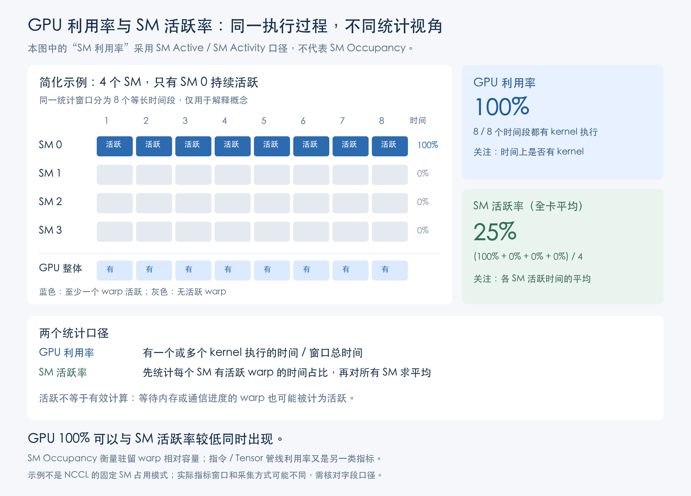

# 训练报错排查详细解释

[通信等待型 GPU Hang 专题](训练卡住排查：通信等待型GPU_Hang.md) · [返回 SOP](训练报错排查SOP.md)

本文解释训练报错排查 SOP 的判断依据、自动检测规则与常见证据的使用方法。

## 多机日志与异常因果

排查时优先寻找明确的代码异常、I/O 异常及对应调用位置，重点查看 NCCL watchdog timeout、SIGTERM 之前的记录。

明确的代码或 I/O 异常通常直接提供致因线索；watchdog timeout 与 SIGTERM 一般是连带结果。因此不应停留于最后的退出日志，也不应把首先报超时的 rank 自动视作故障来源。

具体异常用于确定调查入口，根因描述还应解释触发条件。例如 I/O 错误指向访问失败，但文件不存在、权限、连接或服务异常仍需结合证据区分。SIGTERM 需结合平台事件判断是否属于清理或主动终止。

区分三个层次：看见的报错、异常传播路径、证据支持的根因。时间先后是线索，不能单独代替因果判断。

## GPU Hang 的经验范围

本文的 GPU Hang 指通信等待型异常。训练停止推进还可能由数据、CPU 或其他执行路径阻塞引起。

在该环境中，重点观察多数 GPU 持续 **100%** 利用率且低功率、少数 GPU 为 0% 的模式。优先检查低利用率 GPU 对应的 rank，并结合训练进度、堆栈和节点日志判断。设备与 rank 的对应关系需明确。

99% 利用率可以对应高效率训练，不应将“高利用率”直接等同于 Hang。全 0% 的阻塞归入其他类别，不按这里的通信等待型 GPU Hang 处理。未满足本规则不代表没有其他阻塞。

利用率本身不能独立区分计算与等待，因此经验判断和自动检测都需结合功率及其他证据。

## GPU 利用率与 SM 活跃率

GPU 利用率统计窗口内有一个或多个 kernel 执行的时间占比；SM 活跃率（SM Active／SM Activity）统计每个 SM 至少有一个活跃 warp 的时间占比，再对所有 SM 求平均。两者观察的维度不同。

图：简化为 4 个 SM，只有一个在整个窗口内持续活跃时，GPU 利用率为 100%，全卡平均 SM 活跃率为 25%。这不是 NCCL 的固定 SM 占用模式。SM Active 不等于 Occupancy，等待内存等活动也可计为活跃，因此不能单凭 SM Active 判断有效计算效率。[NVIDIA DCGM 指标定义](https://docs.nvidia.com/datacenter/dcgm/latest/learn/modules/profiling.html)

## 自动检测规则

以下是一套运行环境中的检测配置示例。功率阈值随机型与负载变化，迁移到其他环境前应验证其适用性。

| 项目 | 当前规则 |
| --- | --- |
| 采样周期 | 每 30 秒采样一次 |
| 单次单卡条件 | GPU 利用率为 100%，且功率低于适用机型阈值 |
| 功率阈值 | H100 及以下已覆盖机型为 150 W；H200 为 175 W |
| 单卡判定 | 该 GPU 连续 14 次命中，判定该卡卡住 |
| 任务判定 | 已判定卡住的 GPU 占整个任务 GPU 数量的 50% 及以上，判定任务卡住 |

顺序是**每张卡独立累计连续命中，再汇总卡住的 GPU 比例**。不能改写为“每次有一半 GPU 命中，连续出现 14 次”，因为后者允许每轮命中的卡不同。

连续命中次数与采样周期共同决定检测窗口，但不等于从故障发生到触发的精确时长。

自动检测用于发现异常和触发采证，不是人工查看堆栈的前置条件。NCCL RAS 状态和 Flight Recorder 通信历史可作为进一步诊断的证据入口。

## 平台事件与硬件监控

这些信息应关联到同一故障窗口及节点，帮助解释日志与堆栈。

| 检查对象 | 判断边界 |
| --- | --- |
| 显存 | 区分占用高与实际分配失败，结合报错位置 |
| 主机或容器内存 | 区分整机内存与容器限制，查 OOM kill 等相关记录 |
| IB 网卡与网络 | 关注任务实际使用的接口、故障窗口内的错误变化，不能仅凭历史累计计数归因 |
| 存储流量 | 观察异常，但流量下降可能是访问阻塞，也可能是训练停止后的结果 |
| 平台与 K8s | 关联调度、重启、终止、节点及存储事件，区分先发生的异常和后续清理 |

## 跨 rank 堆栈分析

### 采集与留存

从训练启动起，每分钟采集一次堆栈。工具保留当前时刻之前最近 10 次快照，在训练卡住时输出，可连续查看。无响应 rank 使用最后成功采集的历史记录辅助调查，不能据此声称它当前一定仍停在该位置。

### 横向比较与纵向追踪

1. **分组为入口**：查找偏离多数执行路径的 rank。比较时结合 rank 职责，正常分工也可能产生不同堆栈。
2. **连续快照确认停留**：查看同一 rank 是否持续停留于同一 CPU 调用位置，而非只看某一轮的瞬时差异。
3. **同步关联日志**：结合该 rank 的代码报错、节点系统日志和监控，解释其为何不能推进。

堆栈相同不自动代表正常，分组差异也不直接等于故障；核心是异常执行路径是否能够解释训练无法继续。

### 典型阻塞模式

多数 GPU 处于通信等待；少数 rank 在多次快照中持续停在数据 wait 或 CPU NumPy 计算位置。由于异步执行，CPU 堆栈不一定停在 allreduce 调用处。

这个模式将调查重点从“报通信问题的多数 rank”转向“没有继续推进的少数 rank”。可以先定位阻塞来源，再解释该位置长期停留的原因。相关报错与系统日志仍同步查看。

数据供给、CPU 计算和存储性能的进一步排查见[训练慢详细解释](../训练慢与变慢排查/训练慢与变慢排查详细解释.md)。

## 参考资料

- [PyTorch：Flight Recorder 与 watchdog timeout](https://pytorch.org/blog/flight-recorder-a-new-lens-for-understanding-nccl-watchdog-timeouts/)：解释超时表现和致因 rank 的区别。
- [NVIDIA：nvidia-smi 指标说明](https://docs.nvidia.com/deploy/nvidia-smi/index.html)：GPU 利用率等指标口径。
- [Kubernetes：容器资源管理](https://kubernetes.io/docs/concepts/configuration/manage-resources-containers/)：内存限制及相关行为。

## 网络验证：观察计数器增量

网络异常的恢复流程见[通信等待型 GPU Hang](训练卡住排查：通信等待型GPU_Hang.md)。

许多端口计数是累计值。测试前后针对同一端口、同一指标比较增量，期间需排除清零、设备重置或回绕；不必先清空计数器。已有累计错误但不再增加，与测试期间持续新增错误，含义不同。

| 类别 | 常见字段示例（名称随工具而异） | 解读边界 |
| --- | --- | --- |
| 链路掉线或恢复 | link_downed、link_error_recovery | 新增时关联链路事件，不单独判定网卡损坏 |
| 接收与完整性错误 | port_rcv_errors、local_link_integrity_errors | 是端口或链路调查线索，需要错误明细与时间关联 |
| 发送丢弃 | port_xmit_discards | 结合丢弃原因与网络状态分析 |
| 发送等待 | port_xmit_wait | 缺少 credit 或仲裁等造成等待，不等同于丢包或硬件错误 |

测试前记录端口状态和计数，测试中关联吞吐与错误，测试后比较增量，并与正常节点及交换机端口事件对照。没有新增错误只说明本次未观察到对应异常，不保证消除所有间歇性故障。IB 与 RoCE 的指标不能不加区分地套用，应按实际网络与采集工具确认指标口径。

参考：[NVIDIA 端口计数器](https://docs.nvidia.com/networking/display/ufmtelemetryumv11912/ports%2Bcounters%2Binfo)、[发送等待等指标解释](https://docs.nvidia.com/networking/display/ufmenterpriseumv6193/High-Frequency%2B%28Primary%29%2BTelemetry%2BFields)。
