# DDP 分布式训练：从启动到参数更新

DDP（DistributedDataParallel，分布式数据并行）的基本方式是：**每个训练进程保留完整模型，处理不同数据；在反向传播期间同步梯度，再分别更新自己的参数。**

本文以原生 PyTorch、一进程一卡、NCCL 后端为主线，不涉及平台封装。整体示例为两台机器、每台 8 张 GPU，共 16 个 rank；局部原理图使用更少的 rank。数据链路以 Map-style Dataset、自动组 batch、多进程 DataLoader 为主，不混入 ZeRO、FSDP 或模型并行的数据与参数分片机制。

先阅读总览，再按需查看细节；末尾提供一份自包含完整代码及单机、双机启动命令。

## 目录

- [1. 一次训练的整体流程](#1-一次训练的整体流程)
- [2. 从 torchrun 到训练进程](#2-从-torchrun-到训练进程)
- [3. 初始化与通信验证](#3-初始化与通信验证)
- [4. 数据如何分给各 rank](#4-数据如何分给各-rank)
- [5. DataLoader 如何准备 batch](#5-dataloader-如何准备-batch)
- [6. 本地 forward 与 backward](#6-本地-forward-与-backward)
- [7. bucket 与计算通信重叠](#7-bucket-与计算通信重叠)
- [8. Ring AllReduce](#8-ring-allreduce)
- [9. 为什么同步梯度就能更新参数](#9-为什么同步梯度就能更新参数)
- [10. 梯度累计与 no_sync](#10-梯度累计与-no_sync)
- [11. AMP 与更新顺序](#11-amp-与更新顺序)
- [12. 从原理理解等待与不匹配](#12-从原理理解等待与不匹配)
- [13. 完整示例与运行方式](#13-完整示例与运行方式)
- [14. 保存与恢复边界](#14-保存与恢复边界)
- [参考资料](#参考资料)

## 1. 一次训练的整体流程

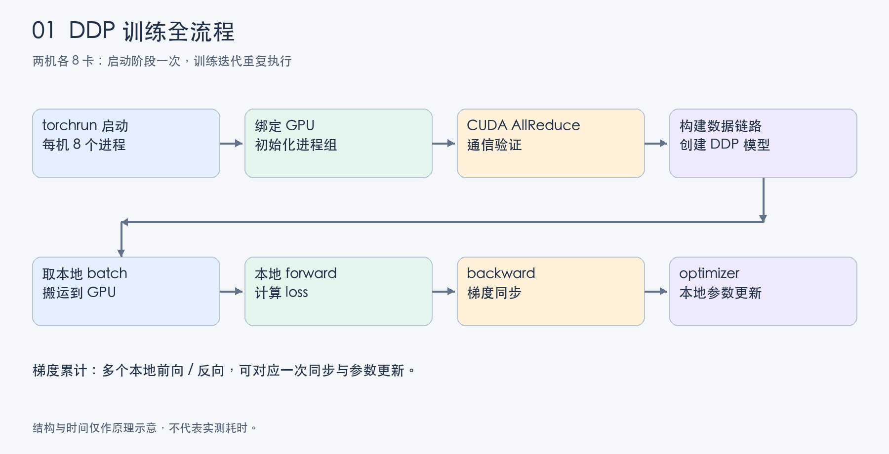

启动时，每台机器的 torchrun 创建本机训练进程；各进程绑定 GPU，加入进程组，构建数据链路和模型。进入训练后，各 rank 取自己的 batch，独立计算 loss，再在 backward 中同步梯度并执行参数更新。

| 对象 | 职责 | 不负责的事情 |
| --- | --- | --- |
| torchrun | 启动和管理训练进程，提供分布式环境信息 | 不执行模型计算，不划分样本 |
| rank | 进程在通信组中的编号 | 不是跨机器通用的 GPU 编号 |
| DDP | 管理模型相关同步与梯度归约 | 不自动切分 Dataset，不替 optimizer 更新参数 |
| DistributedSampler | 为每个 rank 产生样本索引 | 不读取样本，也不通过 NCCL 发送样本 |
| DataLoader worker | 后台读取、处理并整理数据 | 不等同于一个训练 rank |
| optimizer | 根据梯度和优化器状态更新参数 | 标准本地优化器不自动协调各 rank 状态 |

DDP 中每个 rank 都有完整模型，并不意味着它们的数据处理进度始终完全相同。它们通过对应的 collective 建立必要的通信依赖，而不是每行代码之后都有全局 barrier。

## 2. 从 torchrun 到训练进程

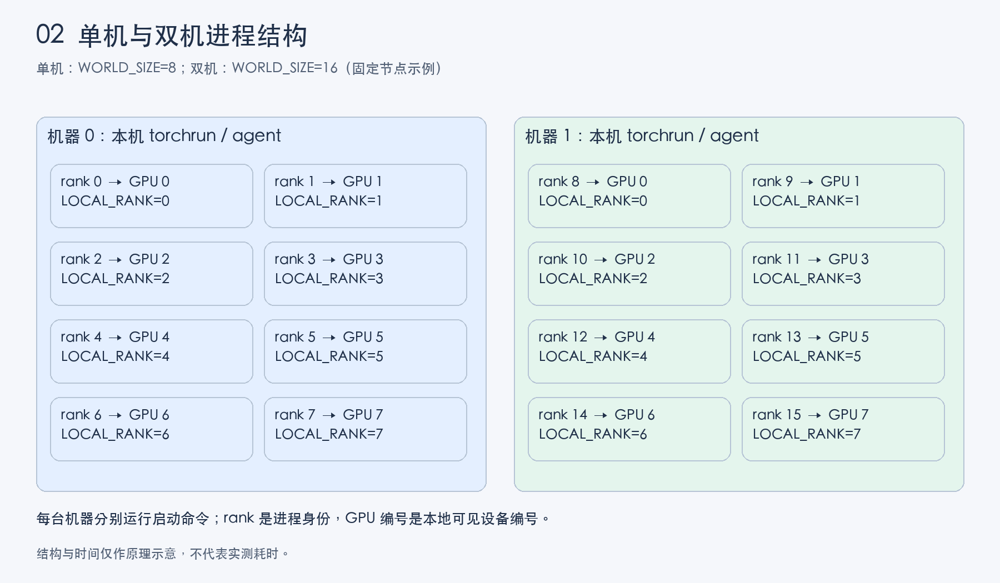

每台机器分别运行 torchrun，其本机 agent 启动 8 个训练子进程。各进程从同一 Python 入口开始执行，但读取到不同身份信息。

| 环境变量 | 单机 8 卡 | 双机各 8 卡 |
| --- | --- | --- |
| WORLD_SIZE | 8 | 16 |
| RANK | 0～7 | 整个任务为 0～15 |
| LOCAL_RANK | 0～7 | 每台机器各自为 0～7 |
| LOCAL_WORLD_SIZE | 8 | 每台机器为 8 |

双机固定节点示例中，机器 0 的 rank 为 0～7，机器 1 为 8～15。弹性重新组网后不能依赖旧 rank 永久不变。`LOCAL_RANK` 对应的是当前进程可见 GPU 的本地编号；例如设置 `CUDA_VISIBLE_DEVICES` 后，逻辑 GPU 0 不一定是机器物理编号 0。

**先创建训练子进程，再由子进程执行初始化。**不要把顺序理解为 torchrun 先在父进程中完成 DDP 初始化，再复制出全部模型。每台机器都需要启动命令；torchrun 不会默认通过 SSH 替其他机器创建进程。

启动参数和环境变量见 [torchrun 官方说明](https://docs.pytorch.org/docs/2.14/elastic/run.html)。完整命令集中放在第 13 节。

## 3. 初始化与通信验证

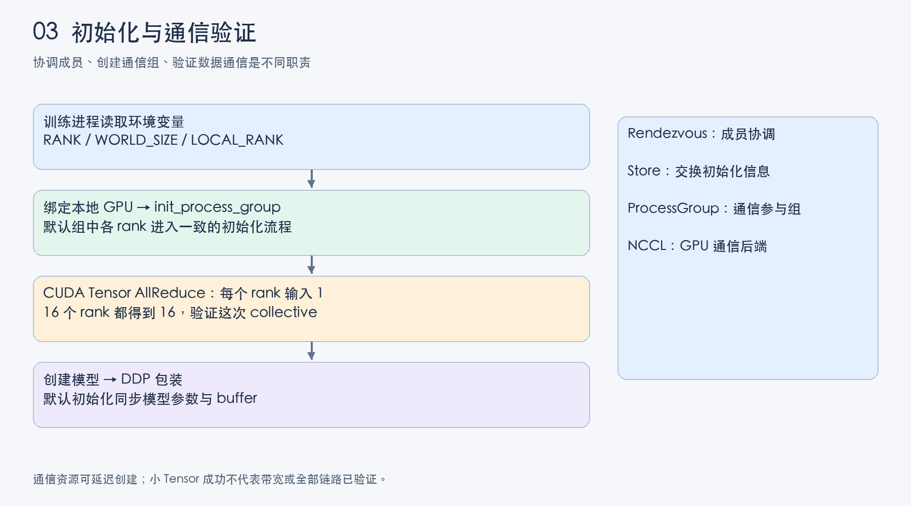

初始化的最小关系是：

```python
local_rank = int(os.environ["LOCAL_RANK"])
torch.cuda.set_device(local_rank)
dist.init_process_group(backend="nccl")
```

`set_device` 决定本进程使用哪张 GPU；`init_process_group` 让本进程加入分布式通信组。默认环境变量初始化方式会使用 torchrun 提供的 rank、world size 和初始化端点信息。

初始化返回不能替代实际通信测试：NCCL 通信资源的创建可能延迟到首次使用，也可能因版本、`device_id` 等参数而提前创建。各 rank 在自己的 GPU 上创建值为 1 的 Tensor，执行 SUM AllReduce，16 个 rank 都应得到 16。它验证这次 collective 的正确性，不代表带宽达标或所有数据规模、路径均已验证。

之后将模型放到对应设备，再包装 DDP。默认初始化同步有助于让各 rank 从一致参数和 buffer 出发。

<details>
<summary>深入理解：Rendezvous、Store、ProcessGroup 与 NCCL</summary>

- **Rendezvous**：协调同一作业的参与者；启动模式不同，成员发现与编号方式也有区别。
- **Store**：提供键值协调能力，交换建立通信所需的信息；不是训练梯度的常规传输通道。
- **ProcessGroup**：表示参与 collective 的进程集合及其通信能力；可以有默认组及额外子组。
- **NCCL communicator**：NCCL 为参与通信的 GPU 建立的通信上下文。一个训练任务可以因子组等原因拥有多个 communicator。

这些概念是职责关系，不是“梯度依次流经四个组件”的数据流水线。应区分初始化协调与实际 GPU 数据通信。

</details>

参考：[torch.distributed](https://docs.pytorch.org/docs/2.14/distributed.html)。

### 3.1 哪些状态会同步

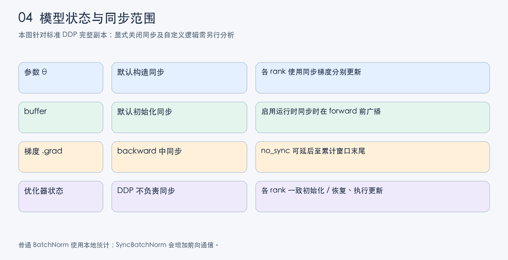

标准 DDP 不在每次 optimizer 更新后广播全部参数。默认构造阶段同步模型状态，训练期间主要归约梯度。启用运行时 buffer 同步时，forward 前还会广播 buffer；旧版本常用参数名为 `broadcast_buffers`，较新接口提供 `forward_sync_buffers`，应按安装版本使用。

普通 BatchNorm 根据本地 batch 计算统计量；同步其运行时 buffer 不等于跨 rank 联合计算当前 batch 统计量。SyncBatchNorm 会增加前向通信。

DDP 不替你同步 Adam 动量等优化器状态，也不自动恢复 scheduler 或 GradScaler。各 rank 需要保持一致的初始化、恢复状态和更新计划。

## 4. 数据如何分给各 rank

### 4.1 数据源、Dataset 对象与实际读取

共享数据源表示各机器能够访问同一份逻辑数据。各 rank 分别创建 Dataset 对象；常见对象只保存索引、路径和读取逻辑，访问样本时才加载内容。自定义 Dataset 也可能主动预加载，不能把惰性读取视为强制行为。

`Dataset[index]` 定义索引到样本的映射；`DistributedSampler` 决定本 rank 使用哪些索引。DDP 不自动分配输入，也不要求 rank 0 读取全部样本再发送给其他 rank。

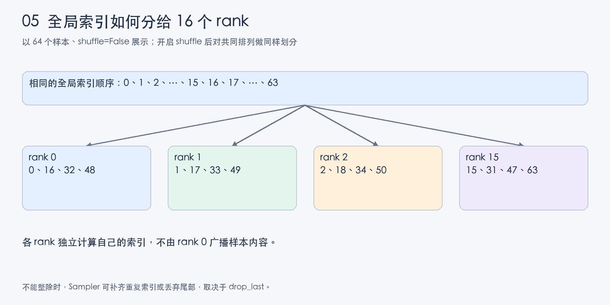

以 64 个样本、16 个 rank、关闭 shuffle 为例，rank r 获取 r、r+16、r+32、r+48。开启 shuffle 后，各 rank 使用相同 seed 与 epoch 计算相同的全局排列，再选取属于自己的位置。这不需要每轮广播索引。

前提是各 rank 的 Dataset 长度及索引语义一致。若不同机器生成了不同文件顺序，索引分片正确也不能保证预期的数据覆盖。

### 4.2 一个 epoch 如何改变顺序

```python
for epoch in range(epochs):
    sampler.set_epoch(epoch)  # 在 iter(loader) 或 for batch in loader 之前
    for batch in loader:
        ...
```

Sampler 的 seed 在各 rank 间保持一致；epoch 让每轮排列变化。随机增强的种子属于另一个层面，不能把“Sampler 使用相同 seed”推广为所有 rank 和 worker 必须产生相同增强。

### 4.3 两个 drop_last 的区别

| 配置 | 处理什么尾部 | 影响 |
| --- | --- | --- |
| DistributedSampler.drop_last=True | 不能均分给全部 rank 的样本尾部 | 丢弃少量索引，使每 rank 数量一致 |
| DistributedSampler.drop_last=False | 同上 | 补齐索引，可能重复少量样本 |
| DataLoader.drop_last=True | 本 rank 最后不足一个 batch 的数据 | 丢弃本地不完整 batch |
| DataLoader.drop_last=False | 同上 | 保留本地小 batch |

补齐样本可能影响精确验证指标；不能未经去重就把重复样本算作额外独立数据。详细接口见 [数据加载文档](https://docs.pytorch.org/docs/2.14/data.html)。

## 5. DataLoader 如何准备 batch

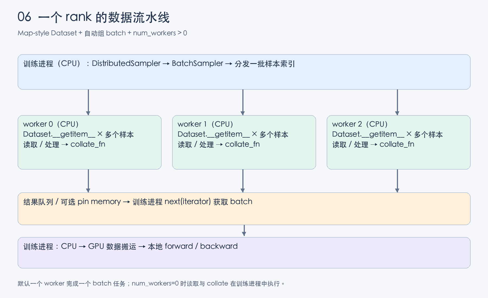

| 组件 | 输入 → 输出 |
| --- | --- |
| DistributedSampler | 全局数据集信息 → 本 rank 索引序列 |
| BatchSampler | 索引序列 → 一批索引 |
| Dataset.__getitem__ | 单个索引 → 读取、解码、预处理后的样本 |
| collate_fn | 多个样本 → batch，例如堆叠 Tensor 或补齐序列 |
| DataLoader | 调度、预取、传递结果 → 向训练进程提供 batch |

逻辑上，一个 batch 的准备可以理解为：

```python
batch = collate_fn([dataset[i] for i in batch_indices])
```

部分 Dataset 提供 `__getitems__` 批量读取优化；上式用于解释常见路径，不代表所有实现必须逐项调用 Python 方法。

### 5.1 训练进程与 worker 的分工

Map-style 多进程加载中，Sampler / BatchSampler 在本 rank 的训练进程中产生索引任务。一个 worker 通常接收一批索引，完成多个样本读取及 collate，返回一个完整 batch；不是每个 worker 默认贡献一个样本再由训练进程拼接。

worker 在创建 DataLoader 迭代器时启动；`persistent_workers=True` 可跨 epoch 保留。它们拥有 Dataset 副本，但不代表每个副本必然将所有样本载入内存。`num_workers=0` 时，读取与 collate 在训练进程执行。

若每 rank 配置 8 个 worker，则每台 8 卡机器有 64 个 DataLoader worker，此外还有训练进程及库线程。该数量只是计数示例，不是通用推荐值；应结合实际 CPU 配额和解码、NumPy、Parquet 等内部线程开销配置。

### 5.2 预取、队列与取数时间

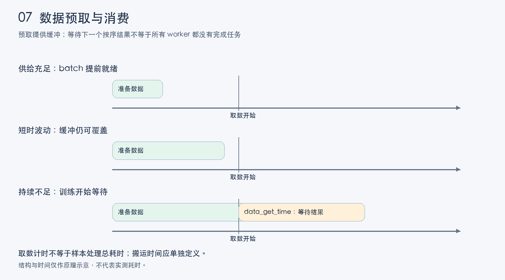

GPU 计算当前 batch 时，后台 worker 可以提前准备后续 batch。队列是缓冲区，不要求每个时刻都物理填满；关键是训练需要下一批时能及时取得结果。

`data_get_time` 指训练进程开始获取下一批数据，到拿到 batch 的耗时。后台处理可能已经被当前计算覆盖，所以取数时间不是数据生产总耗时。默认按序交付时，后续 batch 即使完成，也可能等待前面的慢任务。

预取能缓冲短时波动，不能弥补持续的生产能力不足。`pin_memory` 有助于适当路径下的主机到 GPU 传输；`non_blocking=True` 本身不保证传输与计算已经重叠，仍需看内存条件、stream 和依赖。

更详细的计时口径见[训练慢排查 SOP](../../稳定性与排障/训练慢与变慢排查/训练慢与变慢排查SOP.md)。

<details>
<summary>IterableDataset 为什么需要另外处理分片</summary>

IterableDataset 按 `__iter__` 产生数据，不通过上述 Map-style 索引采样机制。需要在数据源或迭代逻辑中考虑 rank 与 worker 两级分片，避免不同副本重复消费同一数据。还需保证各 rank 训练计划可协调，不能只按 worker 编号划分却忽略全局 rank。

</details>

## 6. 本地 forward 与 backward

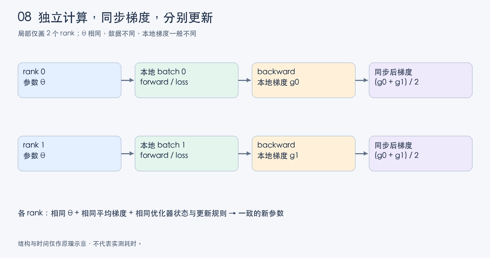

各 rank 参数相同、数据不同，因此输出、loss、本地梯度通常不同。每个 rank 可以直接对本地 loss 调用 backward，不需要先将 loss 跨 rank 汇总。全局平均 loss 若用于日志，需要另行归约。

反向沿计算图逐步产生参数梯度。简单串行网络中，靠近输出端的梯度通常较早就绪；分支、参数共享等会改变实际顺序。梯度产生后，DDP 的 autograd hook 通知 reducer，为 bucket 同步做准备。

**backward 是标准 DDP 梯度同步的主要阶段，不是整个任务唯一通信环节。**初始化、buffer 同步、SyncBatchNorm、指标统计和业务 collective 都可能通信。

## 7. bucket 与计算通信重叠

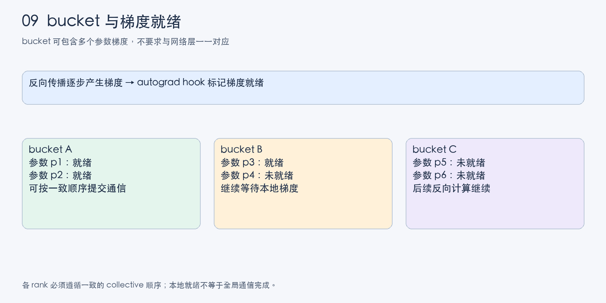

bucket 将多个参数梯度组织成通信单位。当应参与同步的梯度就绪、并满足一致的通信顺序时，可发起对应 AllReduce，同时继续后续反向计算。

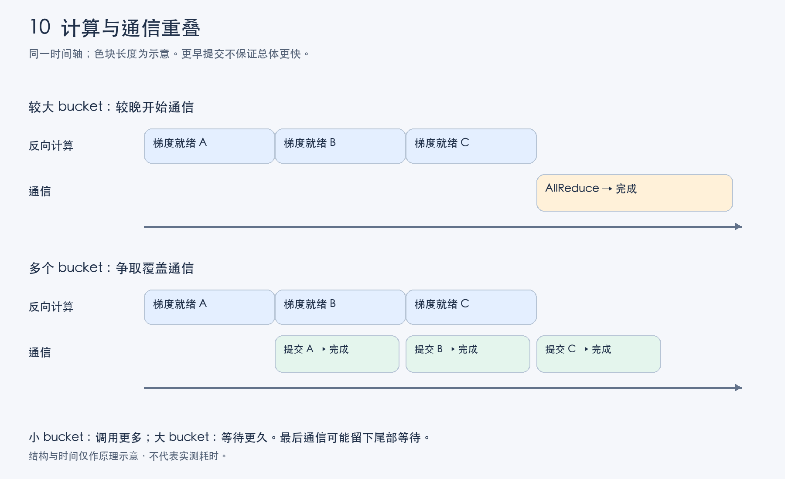

| 倾向 | 收益机会 | 代价风险 |
| --- | --- | --- |
| 较小 bucket | 更早就绪、更早启动通信 | 通信调用增多，小消息开销更明显 |
| 较大 bucket | 减少调用、提高大消息传输效率 | 等待更多梯度，通信启动变晚 |

本地发起通信不代表已完成；其他 rank 可能尚未准备好对应数据。最后就绪的 bucket 可能留下通信尾部。不能仅凭默认参数或模型层数推定最佳 bucket 大小，应看稳定阶段 trace。bucket 还可能随运行过程重建，不能将初始化分组简单视为永远固定。

### 7.1 未使用参数与动态分支

某参数没有参与当前 loss，可能不会按普通路径产生梯度。`find_unused_parameters=True` 用于识别相关参数并协助 reducer 正确处理梯度就绪；它有遍历开销，也不是修复任意自定义通信不匹配的开关。

`static_graph` 等配置需满足其图结构和参数使用条件，不应为了性能盲目开启。不同 rank 执行不同分支时，应分别检查参数使用、DDP 配置和显式 collective 的一致性。

## 8. Ring AllReduce

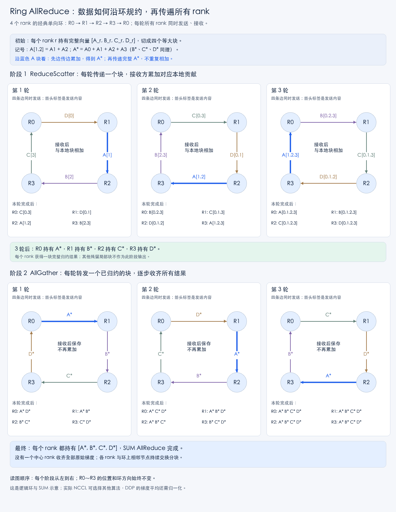

**读图方法**：每个阶段从左到右看，共 3 轮；所有面板保持 R0 → R1 → R2 → R3 → R0 的方向。箭头标注本轮发送的块，下方列出接收后的结果。`A[1,2]` 表示 `A1 + A2`，`A*` 表示四个 rank 的 A 块之和。沿蓝色 A 块追踪：ReduceScatter 中先从 R1 传到 R2，再到 R3，最后到 R0，边传边加上接收方的本地 A 贡献；AllGather 中完整 A* 再从 R0 传到 R1、R2、R3，只保存和转发，不重复累加。每轮四条边并行工作，蓝色只用于突出其中一个块。

假设 4 个 rank 都有梯度向量，将向量分成 A、B、C、D 四块。经典 Ring 方法沿逻辑环交换分块：

1. **ReduceScatter**：边传递边归约，使每个 rank 得到一块汇总所有贡献的结果。
2. **AllGather**：传播已归约的块，使每个 rank 获得完整结果；此时不再重复累加。

经典等分环中，两阶段分别有 W−1 轮；每个 rank 总发送量约为 `2 × (W−1) / W × S`，S 为本次向量字节数。这是简化流量模型，忽略协议等开销，不能直接当实测耗时公式。

Ring 没有集中处理全部归约的唯一主 rank，但不代表任意拓扑下都最优。NCCL 支持多种算法，实际选择受拓扑、消息规模和配置影响。逻辑环也不等于物理网络按环接线。

DDP bucket 划分是“哪些梯度一起发起 collective”，Ring 内部分块是“这次 collective 如何搬运和归约”；一个 bucket 的数据仍可继续分块。

示意使用 SUM。标准 DDP 还提供平均梯度语义，不能把求和直接等同于平均；自定义通信 hook 时尤其需要检查归一化责任。参考 [NCCL collective](https://docs.nvidia.com/deeplearning/nccl/user-guide/docs/usage/collectives.html) 与 [NCCL 算法配置](https://docs.nvidia.com/deeplearning/nccl/user-guide/docs/env.html#nccl-algo)。

## 9. 为什么同步梯度就能更新参数

设 W 个 rank 的本地平均 loss 为 L_r，且每 rank 有相同数量、相同权重的样本。标准平均梯度为：

```text
g_r = ∇θ L_r(θ)
g_mean = (g_0 + … + g_(W−1)) / W
SGD：θ_next = θ − learning_rate × g_mean
```

所有 rank 从一致参数出发，使用一致梯度、超参数、优化器状态和更新规则，就能维持参数一致，不需要每步再次广播参数。

例如两个 rank 的参数均为 10，本地梯度分别为 2 和 6；平均梯度为 4，学习率为 0.1，更新后参数均为 9.6。

### 为什么不先各自更新，再平均参数

对于无动量 SGD 等特定条件，一步本地更新再平均可得到相同的代数结果；不能推广到任意优化器。Adam 使用梯度一阶、二阶历史，平方等非线性操作使“先分别更新再平均参数”通常不等价于“先平均梯度再更新”。局部更新还会形成不同的优化器状态。

DDP 采用同步梯度、分别执行一致更新的闭环。它提供分布式数据并行训练语义，而不是任意参数平均算法的包装。

## 10. 梯度累计与 no_sync

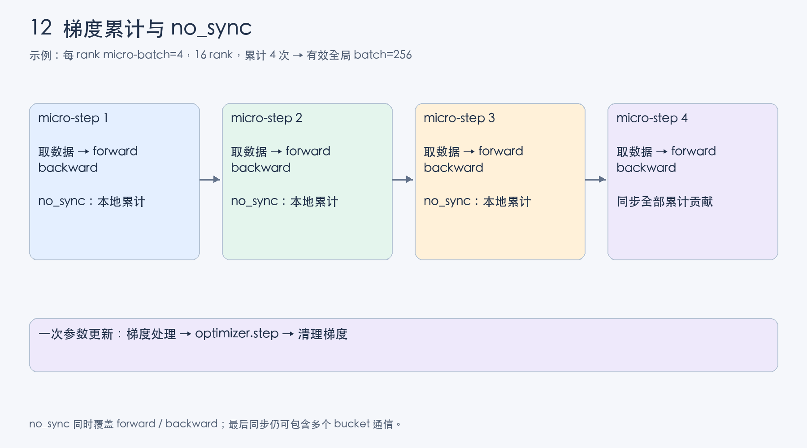

每 rank micro-batch=4、16 个 rank、累计 K=4 时，一个完整更新窗口处理 `16 × 4 × 4 = 256` 个样本。各 micro-batch 分别 forward / backward，参数 `.grad` 累加，不需要保留前面所有计算图。

只减少 optimizer.step 次数不会自动减少 DDP 通信。前 K−1 次用 `no_sync()` 包住 forward 和 backward，最后一次正常执行，即可在窗口末尾同步全部累计贡献。最后同步仍可能有多个 bucket。

loss 为平均值且每份大小相等时，可除以 K。若窗口尾部不足 K 次，应按实际数量归一化；若 batch 大小不同，应按样本数加权。有效 token 数不同的语言模型目标需要按实际目标权重处理，不能机械平均各 batch 的平均 loss。

梯度累计不保证严格等价于一次大 batch：BatchNorm 等跨样本统计看到的仍是 micro-batch，随机过程和浮点求和顺序也可能不同。

区分 micro-step、累计窗口及成功 update-step；取数据时间每个 micro-batch 采集，学习率计划则需明确自己的计数单位。

## 11. AMP 与更新顺序

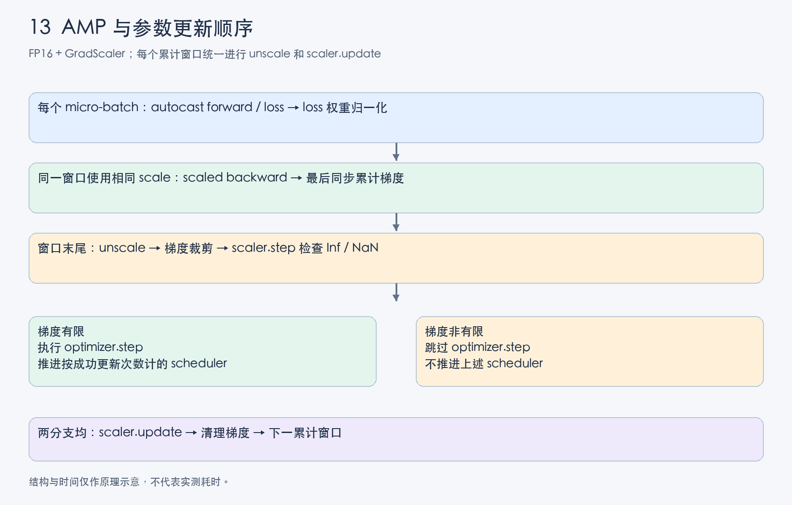

AMP 的三个动作不同：autocast 为算子选择精度；loss 按样本权重归一化定义目标；GradScaler 放大 loss 缓解 FP16 下溢。后两者不能相互替代。BF16 通常不需要 GradScaler，但仍需核对设备支持与数值表现。

一个累计窗口内保持相同 scale，在全部梯度累计完成后才 unscale，然后裁剪、尝试更新、更新 scaler。不要在每个 micro-batch 中单独 unscale 或更新缩放因子。

裁剪对象应是同步、归一化并还原尺度后的梯度。先本地裁剪再平均通常不等价于先平均再裁剪。标准 DDP 完整梯度副本下，每 rank 对相同梯度执行裁剪即可；不能直接套用到梯度分片场景。

FP16 检测到非有限梯度时，scaler.step 可能跳过 optimizer.step。按成功更新次数计数的 scheduler 此时不应推进。本示例使用 optimizer 的公开 step post-hook 判断真正执行的更新，不依赖 optimizer.step 返回值，也不手动修改 scaler 内部字段。

若自定义代码可能在同步后引入 rank 特有的非有限值，或各 rank scaler 状态不同，必须另外协调；标准 DDP 不替任意 rank 特有的更新逻辑保证一致。

调度器也可按 epoch 或验证指标推进，不能对所有类型都“每个 micro-step 调用一次”。参考 [AMP 示例](https://docs.pytorch.org/docs/2.14/notes/amp_examples.html) 和 [学习率调度](https://docs.pytorch.org/docs/2.14/optim.html#how-to-adjust-learning-rate)。

## 12. 从原理理解等待与不匹配

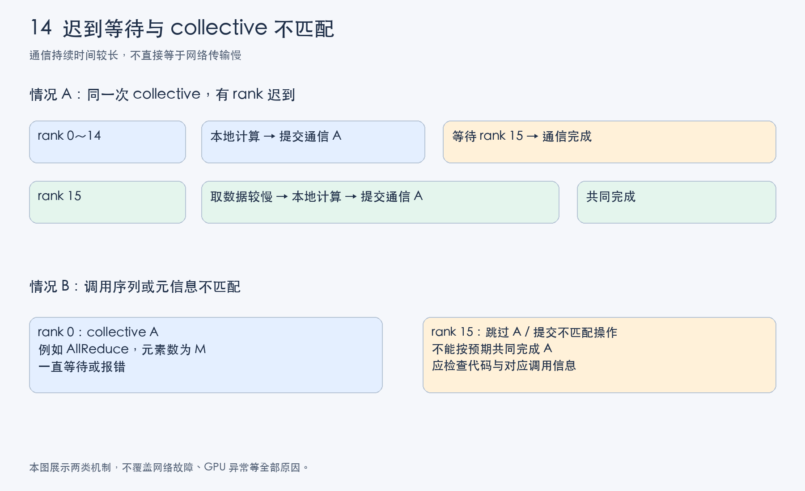

**迟到**：rank 15 数据准备慢，其他 rank 已到达对应梯度通信；长通信中可能包含等待 rank 15 的时间。应跨 rank 找到最早延后的上游步骤，不能只看谁的 NCCL 事件最长。

**不匹配**：同一组的 rank 没有以兼容顺序提交对应 collective，或数据类型、元素数量等不符合该操作约束，可能报错、卡住或产生错误结果。不同 collective 的约束不同，不能概括成“所有通信张量都必须相同 shape”；AllReduce 尤其应核对数量、类型及对应调用序列。

广播、AllReduce 的参数 shape 等约定需结合接口理解；不能仅凭 Python shape 相同就认定通信匹配，也不能用 barrier 修复遗漏调用。某 rank 代码先出错退出时，其他 rank 的 watchdog timeout 也可能只是连带结果。

CPU 与 GPU 异步，Python 堆栈不一定显示当前通信 kernel。进一步诊断见[通信等待型 GPU Hang](../../稳定性与排障/训练报错排查/训练卡住排查：通信等待型GPU_Hang.md)及[训练慢详细解释](../../稳定性与排障/训练慢与变慢排查/训练慢与变慢排查详细解释.md)。

## 13. 完整示例与运行方式

完整文件：[DDP训练示例.py](DDP训练示例.py)。示例使用可按索引生成的二分类数据和小型 MLP，无需下载数据；它用于解释流程，不用于测量实际吞吐、线性度或存储性能。

代码使用 PyTorch 2.x 的 `torch.amp.GradScaler("cuda", ...)`、autocast 和 optimizer post-hook 接口。较旧环境需核对安装版本，不应直接套用最新文档的所有可选参数。

### 13.1 单机 8 卡

```bash
torchrun --standalone --nnodes=1 --nproc-per-node=8 \
  DDP训练示例.py --amp fp16 --workers 2
```

### 13.2 双机各 8 卡

两机安装兼容的 PyTorch、CUDA 与 NCCL 环境，放置相同代码，并具备初始化端点及所选通信链路的可达性。以下 IP 为示例，替换为机器 0 对其他节点可达的地址。

机器 0：

```bash
torchrun --nnodes=2 --nproc-per-node=8 --node-rank=0 \
  --master-addr=192.168.1.10 --master-port=29500 \
  DDP训练示例.py --amp fp16 --workers 2
```

机器 1：

```bash
torchrun --nnodes=2 --nproc-per-node=8 --node-rank=1 \
  --master-addr=192.168.1.10 --master-port=29500 \
  DDP训练示例.py --amp fp16 --workers 2
```

这是固定节点启动方式，不与另一套 elastic rendezvous 参数混用。初始化端口不是 NCCL 数据传输的唯一网络需求。

### 13.3 代码的使用前提

- Sampler 丢弃不可均分尾部，保证各 rank 样本数量一致；DataLoader 保留本地最后的小 batch。
- 累计窗口按实际样本数加权，处理尾部不足 K 次和最后小 batch。各 rank 窗口样本数一致，标准 DDP 平均才对应全局样本平均。
- 为清楚计算窗口权重，先取得本窗口 CPU batch，再逐个搬运计算。这会改变消费节奏并额外占用主机内存，不是推荐的性能优化；真实训练可从批次计划预知权重并流式取数。
- 每 rank 打印 micro-step 取数时间，不对每步强制 CUDA 同步。打印开销和额外指标 collective 会干扰性能，做基准时应调整。
- 每个更新窗口归约日志统计；所有 rank 都参与，只有 rank 0 展示全局 loss。其通信独立于 DDP 梯度同步。
- 默认关闭 AMP，可显式选择 FP16 或 BF16；只启用 FP16 时使用 GradScaler。

无 CUDA 的环境可用以下命令验证 CPU/Gloo 基础流程；它不验证 NCCL、AMP 或 GPU 重叠：

```bash
python -m torch.distributed.run --nnodes=1 --nproc-per-node=2 \
  --master-addr=127.0.0.1 --master-port=29671 \
  DDP训练示例.py --cpu --samples 38 --batch-size 4 \
  --accumulation 4 --workers 2
```

### 13.4 运行验证范围

基础流程在 PyTorch 2.8.0 的双进程 CPU/Gloo 环境验证，覆盖 2 个 DataLoader worker / rank、2 个 epoch、尾部小 batch、累计窗口、调度计数和 checkpoint 保存。另将累计梯度及更新结果与全局 batch 参考计算作了数值对照。该验证不覆盖 CUDA/NCCL、FP16/BF16 AMP 或 GPU 计算通信重叠；实际 GPU 环境需执行上述启动与通信检查。

### 13.5 完整代码

```python
"""原生 DDP 教学示例：一进程一卡；CPU/Gloo 仅用于流程自检。"""
import argparse
from contextlib import nullcontext
from datetime import timedelta
import os
from pathlib import Path
import random
import time

import torch
from torch import nn
import torch.distributed as dist
from torch.nn.parallel import DistributedDataParallel as DDP
from torch.utils.data import DataLoader, Dataset, DistributedSampler


class SyntheticDataset(Dataset):
    """按索引生成确定性样本，不依赖下载；不是存储性能测试。"""
    def __init__(self, size):
        self.size = size

    def __len__(self):
        return self.size

    def __getitem__(self, index):
        generator = torch.Generator().manual_seed(index)
        features = torch.randn(32, generator=generator)
        label = int(features[:4].sum() > 0)
        return features, label


def collate_batch(samples):
    # 多进程加载时，此函数在接到该 batch 索引任务的 worker 中执行。
    features, labels = zip(*samples)
    return torch.stack(features), torch.tensor(labels, dtype=torch.long)


def seed_worker(worker_id):
    # PyTorch 已设置 worker 的 torch seed；为 Python 随机增强初始化种子。
    random.seed(torch.initial_seed() % (2**32))


def parse_args():
    parser = argparse.ArgumentParser()
    parser.add_argument('--cpu', action='store_true', help='CPU/Gloo 流程自检')
    parser.add_argument('--amp', choices=['off', 'fp16', 'bf16'], default='off')
    parser.add_argument('--epochs', type=int, default=2)
    parser.add_argument('--samples', type=int, default=1040)
    parser.add_argument('--batch-size', type=int, default=4)
    parser.add_argument('--accumulation', type=int, default=4)
    parser.add_argument('--workers', type=int, default=2)
    parser.add_argument('--output', default='运行输出')
    args = parser.parse_args()
    if min(args.epochs, args.samples, args.batch_size, args.accumulation) < 1 or args.workers < 0:
        parser.error('轮数、样本数、batch 和累计次数必须为正，workers 不能为负')
    if args.cpu and args.amp != 'off':
        parser.error('CPU 自检仅支持 --amp off')
    return args


def main():
    args = parse_args()
    # torchrun 为每个训练进程注入身份信息；LOCAL_RANK 是本机编号，不能当全局 RANK。
    # 双机各 8 卡时，每台 LOCAL_RANK 都为 0～7，整个任务的 RANK 为 0～15。
    local_rank = int(os.environ['LOCAL_RANK'])
    if args.cpu:
        device, backend = torch.device('cpu'), 'gloo'
        torch.set_num_threads(1)
    else:
        # 为当前进程选择默认 CUDA 设备；此处编号相对于 CUDA_VISIBLE_DEVICES 可见列表。
        # 一个训练进程独占一张 GPU；这一步只绑定设备，还没有建立分布式进程组。
        torch.cuda.set_device(local_rank)
        device, backend = torch.device('cuda', local_rank), 'nccl'
        if args.amp == 'bf16' and not torch.cuda.is_bf16_supported():
            raise RuntimeError('当前设备不支持示例所需的 BF16')

    # 创建默认进程组：约定哪些 rank 共同通信，以及使用哪个后端执行 collective。
    # 所有参与训练的 rank 都要调用；此调用不创建训练子进程，也不包装或更新模型。
    # init_method 未传时采用 env://，从环境读取 RANK、WORLD_SIZE、MASTER_ADDR/PORT。
    # rank / world_size 也可显式指定；torchrun 已提供环境信息，本例不重复手工填写。
    # device_id 是可选设备参数，在支持的版本中可促使 NCCL communicator 提前创建；
    # 本例为兼容基础路径不传入，初始化返回后仍会进行实际 CUDA Tensor 通信验证。
    dist.init_process_group(
        backend=backend,                 # GPU 使用 nccl；CPU 自检使用 gloo。
        timeout=timedelta(minutes=5),     # 进程组操作的超时配置，不是整个训练的运行时限。
    )
    try:
        rank, world_size = dist.get_rank(), dist.get_world_size()
        # 测试实际 Tensor collective，而不只检查进程组初始化是否返回。
        probe = torch.ones(1, device=device)
        # AllReduce：对默认组内所有 rank 的 Tensor 求和，并原地写回每个 rank 的 probe。
        # 各 rank 必须以匹配顺序参与，且本例 Tensor 的元素数量和类型一致。
        # 每人贡献 1，结果应为 world_size；不是把结果只收集到 rank 0。
        dist.all_reduce(probe, op=dist.ReduceOp.SUM)
        if probe.item() != world_size:
            raise RuntimeError('AllReduce 验证结果不符合预期')
        if rank == 0:
            print(f'通信验证通过：backend={backend}, world_size={world_size}', flush=True)

        torch.manual_seed(42)
        dataset = SyntheticDataset(args.samples)
        # 丢弃不能均分到 rank 的尾部，避免补齐重复；与 DataLoader.drop_last 不同。
        # num_replicas / rank 未传时从默认进程组读取；Sampler 分配索引，不传输样本内容。
        # shuffle=True 打乱全局索引；seed 在各 rank 相同，再用 set_epoch 改变每轮排列。
        sampler = DistributedSampler(dataset, shuffle=True, seed=42, drop_last=True)
        loader_options = {}
        if args.workers:
            # prefetch_factor=2：每 worker 的预取任务数，本例自动组 batch 时任务单位为 batch。
            # persistent_workers：跨 epoch 保留 worker；spawn：独立启动解释器，需入口保护。
            loader_options.update(prefetch_factor=2, persistent_workers=True,
                                  multiprocessing_context='spawn')
        # batch_size 是每 rank 的本地 batch，不是全局 batch；num_workers 也是每 rank 数量。
        # sampler 控制索引顺序，不能再同时设置 shuffle=True。
        # collate_fn 把样本列表整理成 batch；worker_init_fn 在各 worker 初始化时执行。
        # generator 控制 worker 基础种子，与 DistributedSampler 的全局 shuffle seed 分开。
        # pin_memory 在 GPU 路径使用页锁定主机内存，为后续主机到设备传输提供条件。
        loader = DataLoader(dataset, sampler=sampler, batch_size=args.batch_size,
                            drop_last=False, num_workers=args.workers,
                            collate_fn=collate_batch, worker_init_fn=seed_worker,
                            generator=torch.Generator().manual_seed(2026 + rank),
                            pin_memory=not args.cpu, **loader_options)
        if len(loader) == 0:
            raise ValueError('样本不足以分配给全部 rank')

        network = nn.Sequential(nn.Linear(32, 64), nn.ReLU(), nn.Linear(64, 2)).to(device)
        # DDP 包装本进程已经放到设备上的完整模型：默认初始化同步模型状态，
        # 并注册 autograd hook / reducer，在 backward 中按 bucket 归约梯度。
        # 它不切分输入、不创建 DataLoader，也不代替 optimizer 更新参数。
        # device_ids：本进程模型使用的 CUDA 设备列表；一进程一卡传 [local_rank]，CPU 传 None。
        # process_group：默认使用上面创建的默认组；传入子组时需对应调整数据与训练语义。
        # bucket_cap_mb：控制梯度 bucket 容量，影响通信调用数量及计算通信重叠。
        # find_unused_parameters：是否遍历计算图识别未参与 loss 的参数；本模型全部参与，
        #   保持默认 False，不能用此开关修复任意显式 collective 不匹配。
        # buffer 运行时同步由 broadcast_buffers（较新版本为 forward_sync_buffers）等控制；
        #   本例沿用默认值，不代表每步广播参数，也不等于自动使用 SyncBatchNorm。
        # 其余可选参数按安装的 PyTorch 版本核对，不应为了性能盲目改动。
        model = DDP(network, device_ids=None if args.cpu else [local_rank])
        # 每个 rank 各自维护 AdamW 参数和动量状态；相同梯度还需要相同状态与超参数，
        # 才能得到一致更新。model.parameters() 返回被包装模型的参数引用。
        optimizer = torch.optim.AdamW(model.parameters(), lr=1e-3)
        # step_size=10：每调用 scheduler.step() 10 次，学习率乘 gamma=0.9。
        # StepLR 常按 epoch 调用，但本例明确按成功参数更新调用，所以这里单位是更新次数。
        scheduler = torch.optim.lr_scheduler.StepLR(optimizer, step_size=10, gamma=0.9)
        # FP16 才启用 loss scaling；off / BF16 时此 scaler 透传相应操作。
        # 放大 loss 缓解下溢，与梯度累计中的 loss 权重归一化是两回事。
        scaler = torch.amp.GradScaler('cuda', enabled=args.amp == 'fp16')
        # 本例分类目标是本地 batch 的样本平均 loss，后续按实际样本数加权累计。
        criterion = nn.CrossEntropyLoss(reduction='mean')
        dtype = torch.float16 if args.amp == 'fp16' else torch.bfloat16

        # 使用公开 optimizer hook，区分 scaler.step 被调用与真正完成参数更新。
        update_state = {'count': 0}
        def record_optimizer_step(optimizer, hook_args, hook_kwargs):
            update_state['count'] += 1
        hook = optimizer.register_step_post_hook(record_optimizer_step)
        micro_step = 0
        for epoch in range(args.epochs):
            # 切换训练模式，影响 Dropout / BatchNorm 等；不会自行执行 forward 或更新参数。
            model.train()
            sampler.set_epoch(epoch)  # 必须在 iter(loader) 前调用。
            # 首次创建迭代器时启动 worker，并开始预取；构造 DataLoader 不等于已完成加载。
            iterator = iter(loader)
            for start in range(0, len(loader), args.accumulation):
                window_size = min(args.accumulation, len(loader) - start)
                # 清理上个窗口的梯度；set_to_none 避免逐项填零，不能在窗口每次反向前都清理。
                optimizer.zero_grad(set_to_none=True)
                # 先取得本窗口 batch，以便按实际样本数加权，包括最后一个小 batch。
                # 最多额外持有一个累计窗口的 CPU 数据；生产代码也可由批次计划预知权重。
                batches, get_times = [], []
                for _ in range(window_size):
                    begin = time.perf_counter()
                    batches.append(next(iterator))
                    get_times.append(time.perf_counter() - begin)
                local_count = sum(target.numel() for _, target in batches)
                statistics = torch.zeros(2, device=device, dtype=torch.float64)
                for offset, ((inputs, targets), get_time) in enumerate(zip(batches, get_times)):
                    micro_step += 1
                    count = targets.numel()
                    # non_blocking 请求异步搬运；是否与计算重叠仍取决于内存、stream 和依赖。
                    inputs = inputs.to(device, non_blocking=not args.cpu)
                    targets = targets.to(device, non_blocking=not args.cpu)
                    # 前几次只在本地累计；最后一次正常 backward 同步整个窗口的累计贡献。
                    # no_sync 只关闭 DDP 梯度同步，不承诺关闭模型内部所有其他 collective。
                    context = nullcontext() if offset == window_size - 1 else model.no_sync()
                    # no_sync 必须覆盖 forward 与 backward。
                    with context:
                        with torch.autocast(device_type=device.type, dtype=dtype,
                                            enabled=args.amp != 'off'):
                            # model(inputs) 经 DDP 包装入口执行本地 forward；无需先归约 loss。
                            loss = criterion(model(inputs), targets)
                            # 按窗口实际样本数归一化，兼容尾部小 batch；等大 batch 时等价于除 K。
                            weighted_loss = loss * (count / local_count)
                        # backward 计算并累加 .grad；最后一个 micro-batch 还触发梯度归约。
                        # 一个累计窗口内保持相同 scale，不能中途 scaler.update 或 unscale。
                        scaler.scale(weighted_loss).backward()
                    # detach 只提取日志数值，不把统计逻辑接入 autograd 计算图。
                    statistics[0] += loss.detach().double() * count
                    statistics[1] += count
                    # 只用于理解取数等待；不强制 CUDA 同步，也不称作 GPU 执行耗时。
                    print(f'rank={rank} epoch={epoch} micro_step={micro_step} '
                          f'data_get_time={get_time:.6f}s', flush=True)

                # 各 rank 样本数相同是本示例 sampler/loader 配置保证的前提。
                # 最后一次 backward 同步的是本窗口全部累计贡献。
                # 还原梯度数值尺度后再裁剪；每个优化器每个更新窗口只 unscale 一次。
                scaler.unscale_(optimizer)
                # max_norm=1.0 是本示例裁剪阈值；裁剪同步后的完整梯度，而非各 rank 局部梯度。
                nn.utils.clip_grad_norm_(model.parameters(), max_norm=1.0)
                before = update_state['count']
                scaler.step(optimizer)  # 非有限梯度时可能不执行 optimizer.step。
                # 根据非有限值检查结果调整下一窗口的 scale；不执行参数更新。
                scaler.update()
                if update_state['count'] > before:
                    scheduler.step()  # 本例按成功参数更新次数调度，各 rank 均执行。
                # 清理上个窗口的梯度；set_to_none 避免逐项填零，不能在窗口每次反向前都清理。
                optimizer.zero_grad(set_to_none=True)

                # 全部 rank 参与；这是日志统计的额外通信，不是 DDP 梯度同步。
                # 默认 op=SUM，原地累加 [loss 总和, 样本数]，两者相除得到全局样本平均。
                # 不能把这行放进 if rank == 0，否则其他 rank 未参与会造成通信不匹配。
                dist.all_reduce(statistics)
                if rank == 0:
                    mean_loss = (statistics[0] / statistics[1]).item()
                    print(f'update={update_state["count"]} loss={mean_loss:.6f} '
                          f'lr={optimizer.param_groups[0]["lr"]:.6g}', flush=True)

            if rank == 0:
                output = Path(args.output)
                output.mkdir(parents=True, exist_ok=True)
                # 同步更新边界保存；不是精确中途恢复的数据游标/RNG 完整快照。
                # model.module 取得原始模型，避免将 DDP 包装器的 module. 前缀写入权重键。
                # state_dict 只含状态，不是序列化整份模型对象；恢复时仍要创建相同模型结构。
                torch.save({'model': model.module.state_dict(),
                            'optimizer': optimizer.state_dict(),
                            'scheduler': scheduler.state_dict(),
                            'scaler': scaler.state_dict(), 'epoch': epoch,
                            'update_step': update_state['count'], 'args': vars(args)},
                           output / '训练检查点.pt')
            dist.barrier()  # 保存边界协调，不能用 barrier 修复训练中的通信不匹配。
        hook.remove()
    finally:
        # 释放当前进程持有的进程组通信资源；各 rank 都需清理，不是只让 rank 0 执行。
        dist.destroy_process_group()


if __name__ == '__main__':
    main()  # spawn 模式下必须有入口保护。
```

## 14. 保存与恢复边界

完整副本 DDP 中，通常让 rank 0 保存模型以避免重复写同一文件；其他 rank 仍要按一致训练计划运行。需要协调时，将同步点放在明确的保存边界。分布式 checkpoint 或分片训练并不适用“只有 rank 0 保存全部状态”的简单规则。

例子保存模型、optimizer、scheduler、scaler、epoch 和成功更新次数。精确恢复还需考虑各 rank 的随机状态、Sampler / 数据游标、worker 预取，以及保存时是否有未提交累计梯度。只保存模型权重适合重新初始化优化器的场景，不等于延续同一训练轨迹。

本例只在 epoch 更新边界保存，不实现精确中途 resume。恢复时各 rank 必须得到一致所需状态，且按设备正确映射加载；DDP 包装本身不会自动恢复优化器或数据进度。

## 参考资料

- [torchrun](https://docs.pytorch.org/docs/2.14/elastic/run.html)：启动、环境变量与进程管理。
- [torch.distributed](https://docs.pytorch.org/docs/2.14/distributed.html)：进程组与 collective。
- [DDP API](https://docs.pytorch.org/docs/2.14/generated/torch.nn.parallel.DistributedDataParallel.html)：状态同步、no_sync 与参数选项。
- [DDP 设计说明](https://docs.pytorch.org/docs/2.14/notes/ddp.html)：reducer、bucket 和计算通信重叠。
- [数据加载](https://docs.pytorch.org/docs/2.14/data.html)：Dataset、Sampler、worker 与 collate。
- [AMP 示例](https://docs.pytorch.org/docs/2.14/notes/amp_examples.html)：累计、unscale、裁剪与跳过更新。
- [NCCL collective](https://docs.nvidia.com/deeplearning/nccl/user-guide/docs/usage/collectives.html)：AllReduce、ReduceScatter、AllGather。
- [NCCL 算法配置](https://docs.nvidia.com/deeplearning/nccl/user-guide/docs/env.html#nccl-algo)：Ring 等算法选择。
